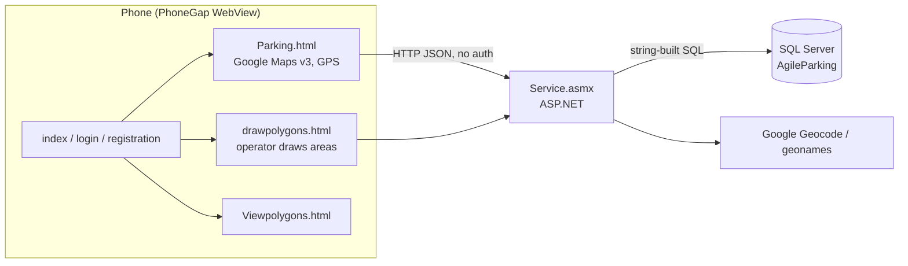
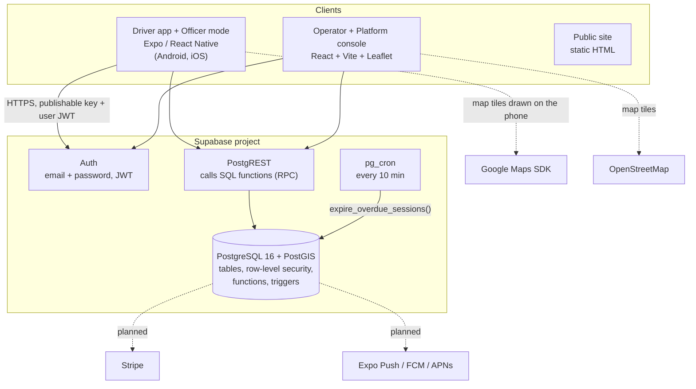
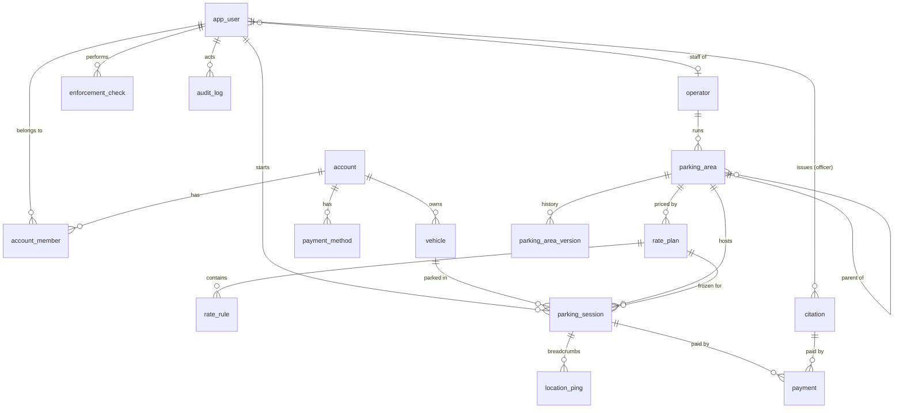
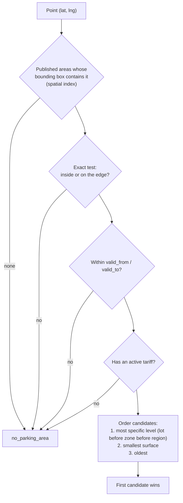
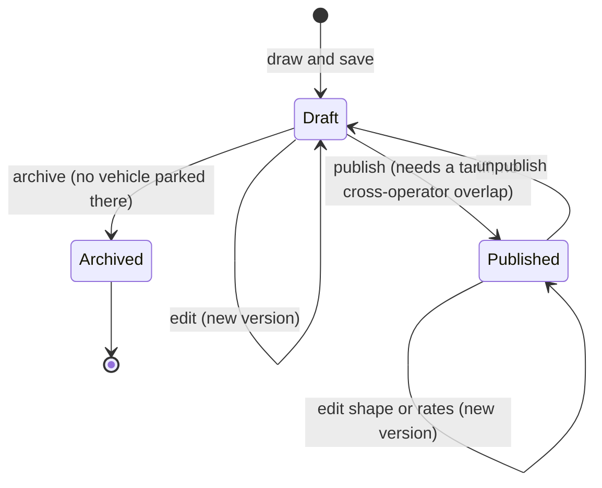
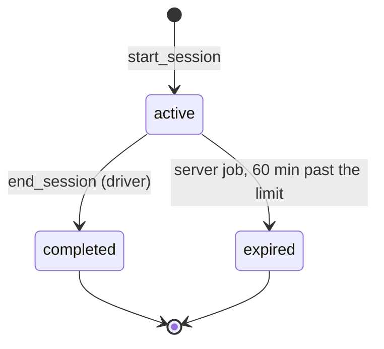
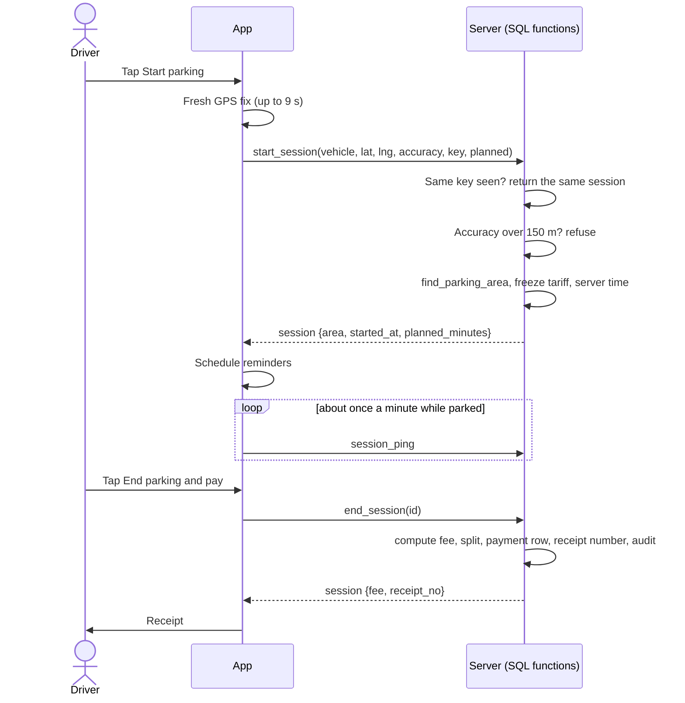
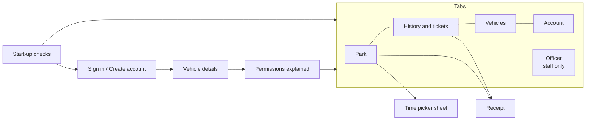

# ParkPay master specification

"ParkPay" is a working name. Diagrams use Mermaid and render on GitHub and in most Markdown viewers.

## Contents

1. Summary and honest status
2. Where this came from: the 2012 prototype and the patents
3. Users and roles
4. System architecture
5. Data model (schema)
6. Server API
7. Geofencing: how a location becomes a parking area
8. Pricing and money
9. Parking session lifecycle
10. Reminders
11. The three surfaces: driver app, officer mode, operator console
12. Security and privacy
13. Testing: what is proven and how
14. Operations: environments, builds, deployment
15. Gap register: what a real launch still needs
16. Roadmap
17. Glossary and file map
18. Compliance audit: this specification checked against the code

---

## 1. Summary and honest status

A driver opens the app, the server works out which paid parking area the phone is in, the driver taps Start, and pays for the exact time when they tap End. Operators need no meters: a parking area is a shape drawn on a map with a price attached. Officers check a licence plate on a phone.

| Part                                                     | Status               | Notes                                                                     |
| -------------------------------------------------------- | -------------------- | ------------------------------------------------------------------------- |
| Driver app (Android, iOS from one codebase)              | Built                | Tested on an Android emulator. Not yet on a physical phone or an iPhone   |
| Officer mode (inside the same app)                       | Built, basic         | Plate check, nearby valid vehicles, issue ticket                          |
| Operator and platform-admin console (web)                | Built                | Clicked through in a browser against the live test project                |
| Backend (database, rules, security) | Built | 7 migrations applied, 169 automated checks pass; the driver flow also passes 20 checks through the public API |
| Geofencing rules and admin safeguards                    | Built and tested     | Section 7                                                                 |
| Public website (privacy, terms, support, delete account) | Drafted              | Legal text not reviewed by a lawyer. Not deployed                         |
| Payments                                                 | **Simulated**  | No money moves. Stripe not connected                                      |
| Push notifications from the server                       | **Not built**  | Needs Firebase and Apple keys. Reminders today are scheduled on the phone |
| Hosting, store listings                                  | **Not done**   | Needs accounts only the owner can open                                    |
| Patent ownership and maintenance fees                    | **Unverified** | Owner's stated position; no assignment document in the project            |

So: the product loop works end to end in test conditions. It is not live, and it cannot take real money yet.

---

## 2. Where this came from: the 2012 prototype and the patents

### 2.1 What the old material is

| Item                                                   | What it is                                                                                                                                    |
| ------------------------------------------------------ | --------------------------------------------------------------------------------------------------------------------------------------------- |
| US 9,792,818 B2                                        | Parking patent. Priority 27 Aug 2012, granted 17 Oct 2017. Inventors listed: Adityakumar Akshaikumar Aggarwal, Sunil Goel. No assignee listed |
| US 10,726,403 B2 (published US 2015/0154578 A1)        | Toll-road patent. Priority 22 Jun 2012, granted 28 Jul 2020. Same inventors                                                                   |
| Patent draft "Centralized parking payment" (June 2012) | The original disclosure with four figures                                                                                                     |
| Pitch decks v7 and v8 (July 2012)                      | Sales material aimed at the Toronto Parking Authority. Its numbers (90% savings, $250 per meter) are marketing claims, not data               |
| 2012 code, versions v0 to v8                           | ASP.NET ASMX web service + PhoneGap (Cordova 1.8) app + SQL Server, packaged for Azure. v7 is the latest                                      |
| NDAs (May 2012)                                        | Between Agile Partners Inc and two recipients. Historical only                                                                                |

The names "Agile Parking" and "Agile Partners" on the deck belong to another company. The new product needs its own name.

### 2.2 What the 2012 code actually did

| Capability                                 | In the 2012 code                        | In the patent or deck         | In the rebuild                                           |
| ------------------------------------------ | --------------------------------------- | ----------------------------- | -------------------------------------------------------- |
| Register a user                            | Yes, plaintext password                 | Yes                           | Yes, hashed by the auth service                          |
| Start and end a session with a GPS fix     | Yes, stored only                        | Yes                           | Yes                                                      |
| Draw parking polygons on a map             | Yes                                     | Yes                           | Yes, with drafts, publishing, versions and overlap rules |
| Fee calculation and rate rules             | **No**                            | Yes                           | Yes                                                      |
| Payment                                    | **No**                            | Yes                           | Simulated; Stripe pending                                |
| Enforcement app, tickets                   | Link to a site that is not in the files | Yes                           | Yes, basic                                               |
| Reminders                                  | No                                      | Yes                           | Yes, on the phone                                        |
| "Moving fast with a session open" reminder | No                                      | Claim 1 of the parking patent | Yes                                                      |
| Toll tracking                              | No                                      | Second patent                 | Tables only; not built                                   |
| Plate OCR, QR sticker                      | No                                      | Optional                      | Not built                                                |

The old code is a record of intent. None of it is reused: it has no authentication, plaintext passwords, SQL injection, and database credentials in about 54 files (locations in `06-security-findings.md`; never copy that folder into a repository).

### 2.3 Ideas carried forward from 2012

| 2012 idea                                                                 | Where it lives now                                              |
| ------------------------------------------------------------------------- | --------------------------------------------------------------- |
| Parking Area = polygon, priced per area because GPS is 5 to 25 m accurate | `parking_area.geom`, `find_parking_area()`                  |
| Session lifecycle Parked, Completed                                       | `session_status` enum                                         |
| Audit table with a client transaction id to reject duplicates             | `idempotency_key` on sessions + `audit_log`                 |
| Store accuracy, speed, heading with the session                           | `start_accuracy_m`, `start_speed_mps`, `location_ping`    |
| Cancel inside 5 minutes                                                   | `rate_plan.grace_minutes` (free minutes)                      |
| UTC timestamps                                                            | `timestamptz` everywhere; operator time zone only for pricing |
| Operator drawing tool                                                     | Console map editor                                              |

### 2.4 Old table to new table

| 2012                                                | 2026                                                                                                                   |
| --------------------------------------------------- | ---------------------------------------------------------------------------------------------------------------------- |
| `UserInfo` (password, plates as a semicolon list) | `app_user`, `account`, `account_member`, `vehicle`; passwords live only in the auth service                    |
| `ParkInfo`                                        | `parking_session`                                                                                                    |
| `Audit`                                           | `audit_log` + idempotency key                                                                                        |
| `geo_LocationTitle`, `geo_LocationTitleCord`    | `parking_area` (one PostGIS shape instead of rows of points)                                                         |
| `geo_log`, `geo_LogCurrentLocation`             | `location_ping` (30-day retention)                                                                                   |
| none                                                | `operator`, `rate_plan`, `rate_rule`, `payment`, `citation`, `enforcement_check`, `parking_area_version` |

---

## 3. Users and roles

One account system. The role on the account decides what a person can see and do.

| Role               | Uses                               | Can                                                                                                       |
| ------------------ | ---------------------------------- | --------------------------------------------------------------------------------------------------------- |
| `driver`         | Mobile app                         | Own profile, vehicles, sessions, receipts, tickets                                                        |
| `officer`        | Officer tab in the same mobile app | Check plates, see valid vehicles nearby, issue tickets, for one operator                                  |
| `operator_admin` | Web console                        | Areas, rates, publish, reports, sessions, refunds, tickets, staff, audit log, for their own operator only |
| `platform_admin` | Web console, extra "Platform" tab  | Everything above for every operator, plus create operators, set the service fee, appoint operator admins  |

Decision recorded: one mobile app (officer is a mode, not a second app) and one web console (platform admin is a tab, not a second site). A second store listing would double release work for a handful of users.

---

## 4. System architecture

Design rules that explain most decisions:

1. **The server decides.** Which area a point is in, what time it is, and what the fee is are all computed in the database. The phone shows estimates only.
2. **No server of our own.** Business logic is SQL functions behind row-level security. There is no API server to host, patch or scale. Stripe and push will need small server functions (Supabase Edge Functions) because they hold secrets.
3. **The phone holds only the publishable key.** The secret key is in the local `.env` and never ships.
4. **The server never calls Google.** Area matching and distances are PostGIS. The map is drawn by the phone's SDK. So there is no per-request Google bill from the backend.
5. **Two backends behind one interface in the app.** `supabaseApi` (live) and `demoApi` (everything on the phone, for demos without a network). Screens do not know which one they use.

### Repository layout

| Path                       | Contents                                                                                                                                                                   |
| -------------------------- | -------------------------------------------------------------------------------------------------------------------------------------------------------------------------- |
| `apps/mobile`            | Expo app (SDK 58, expo-router). `app/` screens, `src/api` (live and demo), `src/state/AppState.tsx`, `src/lib` (notify, background, reminders), `src/components` |
| `apps/ops-console`       | Web console. `App.tsx` (dashboard, areas, staff), `Admin.tsx` (sessions, tickets, audit, platform), `MapEditor.tsx`                                                  |
| `apps/site`              | Public site. Edit `build.mjs`, then `node apps/site/build.mjs`                                                                                                         |
| `packages/shared`        | Types, fee engine, point-in-polygon, demo data. Used by app and console                                                                                                    |
| `supabase/migrations`    | The schema and all server logic, in order                                                                                                                                  |
| `supabase/tests/run.mjs` | Database test suite                                                                                                                                                        |
| `database/`              | Original schema draft and cleaned 2012 SQL (reference)                                                                                                                     |
| `docs/`                  | This file, the plan, build and setup guides, the 2012 knowledge base                                                                                                       |

---

## 5. Data model (schema)

Source of truth: `supabase/migrations/*.sql`. Money is integer cents. Times are UTC.

### 5.1 Tables

| Table                                                          | Purpose                                                                                       | Key columns                                                                                                                                                                                                                                                                                                 |
| -------------------------------------------------------------- | --------------------------------------------------------------------------------------------- | ----------------------------------------------------------------------------------------------------------------------------------------------------------------------------------------------------------------------------------------------------------------------------------------------------------- |
| `app_user`                                                   | One row per person. Created by a trigger when the auth service creates a user                 | `id` (= auth user id), `email`, `full_name`, `role`, `operator_id`, `deleted_at`                                                                                                                                                                                                                |
| `account`                                                    | Billing owner. One personal account per user today; family and business kinds exist for later | `kind`, `owner_user_id`                                                                                                                                                                                                                                                                                 |
| `account_member`                                             | Who may use an account                                                                        | `account_id`, `user_id`, `is_admin`                                                                                                                                                                                                                                                                   |
| `vehicle`                                                    | A plate. Stored normalised (upper case, letters and digits only)                              | `plate`, `plate_region`, `nickname`, `make`, `model`, `colour`, `size_class` (compact, standard, large), `is_default`, `archived_at`                                                                                                                                                      |
| `payment_method`                                             | Provider tokens only, never card data. Unused until Stripe                                    | `provider_customer_id`, `provider_method_id`                                                                                                                                                                                                                                                            |
| `operator`                                                   | A city authority or lot owner                                                                 | `name`, `country`, `timezone`, `currency`, `service_fee_bps`                                                                                                                                                                                                                                      |
| `parking_area`                                               | A shape with a price                                                                          | `operator_id`, `level` (1 region, 2 city zone, 3 lot or street), `name`, `geom` (MultiPolygon, WGS84), `max_stay_minutes`, `closing_time` (operator-local), `active` (published), `valid_from`, `valid_to`, `archived_at` |
| `parking_area_version`                                       | Snapshot on every save, publish and unpublish                                                 | `area_id`, `version`, `action`, `snapshot` (JSON), `actor_user_id`                                                                                                                                                                                                                                |
| `rate_plan`                                                  | The tariff of an area                                                                         | `area_id`, `currency`, `min_charge_cents`, `daily_max_cents`, `grace_minutes`, `active`                                                                                                                                                                                                         |
| `rate_rule`                                                  | One tariff line                                                                               | `days_of_week` (1 Mon to 7 Sun), `start_time`, `end_time`, `price_per_hour_cents`, `priority`                                                                                                                                                                                                     |
| `parking_session`                                            | A parking stay                                                                                | `user_id`, `vehicle_id`, `plate_snapshot`, `area_id`, `rate_plan_id`, `status`, `started_at` (server time), `ended_at`, `planned_minutes`, `start_location`, `start_accuracy_m`, `fee_cents`, `service_fee_cents`, `operator_payout_cents`, `receipt_no`, `idempotency_key` |
| `location_ping`                                              | Position about once a minute while parked. Deleted after 30 days                              | `session_id`, `recorded_at`, `location`, `accuracy_m`, `speed_mps`                                                                                                                                                                                                                                |
| `payment`                                                    | One row per charge. Provider is `mock` today                                                | `session_id` or `citation_id`, `amount_cents`, `refunded_cents`, `status`                                                                                                                                                                                                                         |
| `citation`                                                   | A ticket                                                                                      | `officer_id`, `plate`, `area_id`, `reason`, `fine_cents`, `status` (issued, paid, appealed, void)                                                                                                                                                                                               |
| `enforcement_check`                                          | Every plate lookup by an officer                                                              | `plate`, `result`, `location`                                                                                                                                                                                                                                                                         |
| `audit_log`                                                  | Who did what                                                                                  | `actor_user_id`, `entity`, `entity_id`, `action`, `request` (JSON)                                                                                                                                                                                                                                |
| `notification`, `fraud_flag`, `toll_road`, `toll_trip` | Present for later phases; no logic yet                                                        |                                                                                                                                                                                                                                                                                                             |

### 5.2 Rules the database enforces by itself

| Rule                                                                                                                            | How                                                           |
| ------------------------------------------------------------------------------------------------------------------------------- | ------------------------------------------------------------- |
| A vehicle has at most one running session                                                                                       | Unique partial index on `vehicle_id` where status is active |
| A retried "start" never creates a second session                                                                                | Unique `(user_id, idempotency_key)`                         |
| An account has one default vehicle                                                                                              | Unique partial index                                          |
| A completed session always has an end time and a fee                                                                            | Check constraint                                              |
| A plate is always stored normalised                                                                                             | Trigger + check constraint                                    |
| An area shape is valid, on the globe, within size limits, and a published lot does not overlap another operator's published lot | Trigger `parking_area_guard` (section 7.4)                  |
| A new auth user gets a profile and a personal account                                                                           | Trigger `handle_new_auth_user`                              |

### 5.3 Indexes that matter for speed

| Query                          | Index                                                |
| ------------------------------ | ---------------------------------------------------- |
| Which area contains this point | GiST on `parking_area.geom`                        |
| Is this plate validly parked   | Partial index on `plate_snapshot` where active     |
| Who is parked in this area now | Partial index on `area_id` where active            |
| My history                     | `(user_id, started_at desc)`                       |
| The tariff of an area          | Partial index on `rate_plan(area_id)` where active |

---

## 6. Server API

Clients call SQL functions through Supabase RPC (`POST /rest/v1/rpc/<name>` with the user's JWT). Every function checks the caller's identity from the token, never from a parameter. Errors are short codes (for example `no_parking_area`) that the app turns into sentences (`apps/mobile/src/api/errors.ts`).

### 6.1 Driver

| Function                                                                    | Does                                                                       |
| --------------------------------------------------------------------------- | -------------------------------------------------------------------------- |
| `my_profile()`, `update_profile(name)`                                  | Read and change own profile                                                |
| `list_areas(lat, lng, radius_m)`                                          | Published areas near a point, with shape and tariff. Radius 100 m to 50 km |
| `detect_area(lat, lng)`                                                   | The one area this point is in, or null                                     |
| `get_area(id)`                                                            | One area by id (the area a session was started in, even after moving away) |
| `start_session(vehicle, lat, lng, accuracy, speed, key, planned_minutes)` | Matches the area, freezes the tariff, starts the clock                     |
| `extend_session(id, planned_minutes)` | Changes the planned time of a running session (counted from its start; null = until I end it). Never below the time already used, never above the maximum stay |
| `end_session(id, lat, lng)` | Computes the fee, splits it, records the payment, issues a receipt number  |
| `my_active_session()`, `my_sessions(limit)`                             | Current session; history                                                   |
| `session_ping(id, lat, lng, accuracy, speed)`                             | Breadcrumb while parked                                                    |
| `my_citations()`, `pay_citation(id)`                                    | Tickets against my plates; pay one (simulated)                             |
| `delete_my_account()`                                                     | Anonymises the profile, removes the sign-in. Refused while parked          |
| Vehicles                                                                    | Direct table access under row-level security (insert, update, select own)  |

### 6.2 Officer

| Function                                                          | Does                                             |
| ----------------------------------------------------------------- | ------------------------------------------------ |
| `officer_check_plate(plate, region, lat, lng)`                  | valid, expired, no_session or wrong_area; logged |
| `officer_valid_vehicles(lat, lng, radius_m)`                    | Plates with a running session near the officer   |
| `officer_issue_citation(plate, region, reason, fine, lat, lng)` | Creates a ticket                                 |
| `officer_recent_citations(limit)`                               | Own tickets                                      |

### 6.3 Operator admin

| Function                                                                 | Does                                                                |
| ------------------------------------------------------------------------ | ------------------------------------------------------------------- |
| `operator_areas()`                                                     | All own areas, drafts included                                      |
| `operator_check_area(area_id, level, geojson)`                         | Size, limit problems and overlaps for a shape that is not saved yet |
| `operator_save_area(...)`                                              | Create or edit shape and tariff in one call; writes a version       |
| `operator_publish_area(id, publish)`                                   | Publish or unpublish; writes a version                              |
| `operator_set_area_hours(id, closing_time)` | Sets or clears the closing time |
| `operator_archive_area(id)` | Removes an area from drivers and from the list for good; refused while a vehicle is parked there. History and receipts stay |
| `operator_area_versions(id)` | History of an area |
| `operator_report(from, to)`, `operator_report_series(from, to)`      | Totals; per day and per hour of day                                 |
| `operator_active_sessions()`                                           | Who is parked now                                                   |
| `operator_sessions(from, to, search, limit)`                           | Session list, search by plate or receipt, source of the CSV export  |
| `operator_refund_session(id, amount, reason)`                          | Records a full or partial refund                                    |
| `operator_citations(from, to)`, `operator_void_citation(id, reason)` | Tickets                                                             |
| `operator_set_user_role(email, role)`                                  | Make a user an officer, or a driver again                           |
| `operator_audit_log(limit)`                                            | Changes by own staff                                                |

### 6.4 Platform admin

| Function                                                                | Does                                                          |
| ----------------------------------------------------------------------- | ------------------------------------------------------------- |
| `admin_operators()`                                                   | All operators with fee, area count, admins                    |
| `admin_save_operator(id, name, country, timezone, currency, fee_bps)` | Create an operator, or change name and fee. Fee capped at 50% |
| `admin_set_operator_admin(email, operator_id)`                        | Appoint or remove an operator admin                           |

### 6.5 Internal (not callable by clients)

`find_parking_area`, `compute_fee_cents`, `split_fee`, `expire_overdue_sessions`, `_me`, `_require_staff`, `_can_manage_area`, `_plan_for_area`, `_area_json`, `_session_json`, `_snapshot_area`, `dev_set_role` (bootstrap of the first staff user, SQL editor only).

### 6.6 Error codes

`not_authenticated`, `forbidden`, `vehicle_not_found`, `no_parking_area`, `no_rate_plan`, `invalid_location`, `location_too_inaccurate`, `rate_limited`, `max_stay_reached`, `invalid_time`, `area_has_active_sessions`, `session_already_active`, `session_not_active`, `session_not_found`, `end_active_session_first`, `invalid_geometry`, `area_too_small`, `area_too_large`, `area_too_complex`, `area_overlaps_other_operator`, `area_not_found`, `operator_required`, `invalid_amount`, `reason_required`, `nothing_to_refund`, `citation_not_found`, `citation_not_payable`, `citation_already_paid`, `invalid_fee`, `invalid_timezone`, `user_not_found`.

---

## 7. Geofencing: how a location becomes a parking area

"Geofence" is used for two different things. Keeping them apart avoids most confusion.

|           | Server match                                    | Phone geofence                                     |
| --------- | ----------------------------------------------- | -------------------------------------------------- |
| Shape     | The exact polygon the operator drew             | A circle around the polygon                        |
| Runs      | In the database, on every start and area lookup | In the phone's operating system, in the background |
| Used for  | Deciding the area and the price                 | Waking the app to say "you have arrived"           |
| Authority | Final                                           | A hint only                                        |

### 7.1 The match rule (one rule, used everywhere)

- A point on an edge or a corner counts as inside.
- A hole in a shape is outside the shape.
- An area that fails any test is skipped, and the next candidate is tried. A lot without rates therefore falls through to the city zone around it instead of failing.
- `list_areas` (what the app draws) applies the same filters as `find_parking_area` (what the server charges), so the app never offers an area the server will refuse.

### 7.2 The phone agrees with the server

The app also runs the match locally (`packages/shared/src/geo.ts`) so the screen updates instantly while moving. The server repeats the match at Start and its answer is the one that counts; the session returned by the server names the area. A test compares the phone's algorithm with PostGIS on 400 random points across overlapping shapes and a shape with a hole, and compares the area picked on 60 points. Mismatches: 0.

### 7.3 GPS accuracy

| Situation                          | Behaviour                                                                                                          |
| ---------------------------------- | ------------------------------------------------------------------------------------------------------------------ |
| Normal fix (5 to 25 m)             | Accepted                                                                                                           |
| Reported accuracy worse than 150 m | Start is refused with `location_too_inaccurate`; the app asks the driver to wait                                 |
| Driver is near a border            | The app shows the detected area name and price before Start; the driver confirms by tapping. Never a silent charge |
| No fix                             | Start is refused; the app explains how to turn location on                                                         |

### 7.4 What an admin may draw (enforced in the database)

| Check                                                                                   | Limit                                                                       | Error                                  |
| --------------------------------------------------------------------------------------- | --------------------------------------------------------------------------- | -------------------------------------- |
| Shape is valid                                                                          | Self-crossing outlines are repaired on save                                 | `invalid_geometry`                   |
| Coordinates are on the globe                                                            | -180..180, -90..90                                                          | `invalid_geometry`                   |
| Complexity                                                                              | At most 5,000 points                                                        | `area_too_complex`                   |
| Lot or street (level 3) size                                                            | 10 m² to 5 km²                                                            | `area_too_small`, `area_too_large` |
| City zone (level 2) size                                                                | Up to 50,000 km²                                                           | `area_too_large`                     |
| Published lot overlapping **another operator's** published lot by more than 1 m² | Refused                                                                     | `area_overlaps_other_operator`       |
| Overlap with **your own** area                                                    | Allowed, shown as a warning: the smaller area's rate applies in the overlap | none                                   |
| Editing or publishing another operator's area                                           | Refused                                                                     | `area_not_found`                     |

Why the cross-operator rule exists: the smallest area wins a match, so without it one operator could draw a small shape inside a competitor's lot and collect its fees.

### 7.5 Area lifecycle and what drivers see

| Admin action     | Effect on drivers                                                                                                                      |
| ---------------- | -------------------------------------------------------------------------------------------------------------------------------------- |
| Publish          | Open apps pick it up within 60 seconds (periodic refresh), and at once when the app is opened or pulled to refresh                     |
| Unpublish        | No new sessions there. A session already running continues and can be ended and paid normally                                          |
| Change rates     | New sessions use the new rates. A session already running keeps the rates it started with (the old tariff is retired, not overwritten) |
| Archive | Gone from drivers and from the console list; cannot be published again. Sessions, receipts and versions are kept |
| Set a closing time | Shown on the area card ("Closes at 23:00") and used for a reminder |
| Change the shape | New matches use the new shape. A running session keeps its area; only the "did you leave?" reminder follows the new outline            |

Every save, publish and unpublish stores a full snapshot in `parking_area_version` and a line in `audit_log`.

### 7.6 The console while drawing

On every change of the shape the console asks `operator_check_area` and shows the surface, any limit problem, and each overlap by name and size. Save is blocked for a shape that cannot be stored. A new drawing always starts a new draft; it never replaces the outline of the area that happens to be open (only dragging corners edits the open area).

### 7.7 Phone geofences for the arrival reminder

The operating system supports only circles, and iOS about 20 at once. The app therefore registers the 15 nearest published lots as circles (centre of the shape, radius to its farthest corner, minimum 100 m, maximum 1.5 km), and re-picks them when the area list refreshes. On entry, if no session is running and this area has not nudged in the last two hours, it shows "You are at City Hall Lot, $4.00 per hour now". Needs location permission "Allow all the time". Without it, nothing happens and the rest of the app works.

---

## 8. Pricing and money

### 8.1 Fee calculation

Implemented twice with the same test vectors: `compute_fee_cents` in SQL (authoritative) and `computeFeeCents` in TypeScript (estimate on screen).

1. Free minutes: if the stay is within `grace_minutes`, the fee is 0.
2. For each clock minute the stay touches, find the rate rule that applies at that minute in the **operator's time zone** (day of week and time of day; the highest `priority` wins when rules overlap). Add that minute's share of the hourly price. Minutes with no rule cost nothing.
3. Round the total up to a whole cent.
4. Cap it at `daily_max_cents` for each started 24 hours of the stay (a 30-hour stay is capped at twice the daily maximum). This is per 24 hours of parking, not per calendar day.
5. Raise it to `min_charge_cents` if it is below that.

Because step 2 counts clock minutes, a stay from 10:00:30 to 11:00:30 touches 61 minutes and is billed as 61.

Daylight-saving changes and rate changes in the middle of a stay are covered by tests.

### 8.2 Split

`service_fee_cents = floor(fee * service_fee_bps / 10000)`; `operator_payout_cents = fee - service_fee`. The percentage is set per operator by the platform admin.

### 8.3 Payment today and with Stripe

| Step   | Today                                                     | With Stripe (planned)                                          |
| ------ | --------------------------------------------------------- | -------------------------------------------------------------- |
| Start  | Nothing                                                   | Place a hold on the saved card                                 |
| End    | A `payment` row with provider `mock`, status captured | Capture the exact fee, release the rest of the hold            |
| Payout | Calculated only                                           | Stripe Connect transfers to the operator minus the service fee |
| Refund | Recorded in `payment.refunded_cents`                    | A server function calls Stripe, then records it                |
| Ticket | Simulated                                                 | Same card flow                                                 |

### 8.4 Receipts

`PP-<year>-<six digits>` from a database sequence. Numbers are unique; gaps can occur.

---

## 9. Parking session lifecycle

`cancelled` and `disputed` exist in the enum for later use.

**Overdue sessions.** Every 10 minutes the server closes any session that is 60 minutes past the area's maximum stay (or past 24 hours where there is no maximum). It is closed **at the limit**, charged for the time up to the limit only, marked `expired`, and given a receipt. This caps what a forgetful driver can be charged. Whether to add a penalty or a ticket instead is a business decision (section 15).

---

## 10. Reminders

All are local notifications created by the app. None needs a server today.

| Reminder                           | When                                                                                   | Needs                            |
| ---------------------------------- | -------------------------------------------------------------------------------------- | -------------------------------- |
| Planned time almost up             | 10 minutes before the time the driver chose (half-way for stays of 20 minutes or less) | Notifications                    |
| Planned time is up                 | At the chosen time                                                                     | Notifications                    |
| Maximum stay soon / reached        | 15 minutes before, and at, the area's limit                                            | Notifications                    |
| Area closes soon | 15 minutes before the area's closing time (5 if it closes sooner) | Notifications |
| Still parked? | After 4 hours where there is no plan and no limit                                      | Notifications                    |
| Forgot to end                      | After 12 hours                                                                         | Notifications                    |
| Did you leave?                     | Position outside the area for two readings while moving                                | App open, or background location |
| Driving with parking still running | Speed of 25 km/h or more for three readings with a session open (patent claim 1)       | App open, or background location |
| You have arrived                   | Entering a registered circle (section 7.7)                                             | Background location              |

Limits to state plainly: a phone that is off, in battery saver, or has notifications disabled will not remind. That is why the server also closes overdue sessions. Server push (ticket issued, payment failed, session closed for you) is not built.

When the driver changes the planned time mid-session, all timed reminders are cancelled and scheduled again from the new plan.

Permissions are asked once, each after an in-app explanation: location and notifications during sign-up, background location after the first session starts.

---

## 11. The three surfaces

### 11.1 Driver app

| Screen                   | What it does                                                                                                                                                  |
| ------------------------ | ------------------------------------------------------------------------------------------------------------------------------------------------------------- |
| Start-up                 | Three visible steps with time limits; can never hang                                                                                                          |
| Sign in / Create account | Email and password; inline validation; "Forgot password?" emails a reset link; demo mode switch |
| Sign-up steps            | Vehicle (plate, region, make, model, colour, size), then why location and reminders are needed. Shown once; also once to an older account that has no vehicle |
| Park                     | Map (or a list where the map is unavailable), detected area and price, vehicle, wheel time picker, Start. While parked: timer, cost so far, time left, "Change my time" (same wheel, counted from now), closing time, End |
| History                  | Sessions with receipts; tickets with Pay                                                                                                                      |
| Vehicles                 | Add, remove, set default                                                                                                                                      |
| Account                  | Name, sign out, delete account                                                                                                                                |
| Officer (staff only)     | Check a plate, list valid vehicles nearby, issue a ticket                                                                                                     |

### 11.2 Console

| Tab                            | What it does                                                                                                         |
| ------------------------------ | -------------------------------------------------------------------------------------------------------------------- |
| Dashboard                      | Revenue, payout, parked now, tickets; revenue per day and sessions per hour charts; revenue by area; parked-now list |
| Areas and rates | Map editor, draft and publish, live size and overlap check, tariff lines, maximum stay, closing time, import a shape from a GeoJSON file, archive, version history |
| Sessions                       | Search by plate or receipt, CSV export, refund                                                                       |
| Tickets                        | List, void with a reason                                                                                             |
| Staff                          | Make a user an officer or a driver                                                                                   |
| Audit log                      | Who changed what                                                                                                     |
| Platform (platform admin only) | Operators, service fee, operator admins                                                                              |

### 11.3 Public site

Home (how it works, for operators), privacy policy, terms, support, delete my account, and the page where a driver sets a new password from the emailed link. Both stores require a privacy policy and a public account-deletion page.

---

## 12. Security and privacy

| Topic                   | How it is handled                                                                                                                                        |
| ----------------------- | -------------------------------------------------------------------------------------------------------------------------------------------------------- |
| Identity                | Supabase Auth issues a signed token. Functions read the user from the token                                                                              |
| Authorisation           | Row-level security on every table; a table with no policy is unreachable. Staff functions check the role and the operator                                |
| Secrets                 | Phone and console carry the publishable key only. The secret key and database password are in a local `.env` that is not committed                     |
| Injection               | No dynamic SQL from client input                                                                                                                         |
| Replay and double taps | Idempotency key on Start |
| Runaway clients | At most 30 session starts per user per hour (`rate_limited`); sign-in attempts are limited by the auth service |
| Tampered clock or price | Server time and server fee only                                                                                                                          |
| Location data           | Collected at start, end and about once a minute while parked; breadcrumbs deleted after 30 days; arrival and leave checks run on the phone               |
| Account deletion        | In the app and by email; profile anonymised, sign-in removed, financial records kept without the name                                                    |
| Audit                   | Every start, end, save, publish, refund, role change, ticket payment and void                                                                            |
| Maps key                | Read at build time from the environment; not in the repository. **Must be restricted** to the app's package and signing fingerprint before release |
| 2012 code               | Kept out of every repository; holds old credentials                                                                                                      |

Known weaknesses are listed in section 15 rather than hidden here.

---

## 13. Testing: what is proven and how

| Layer                 | Command                                                          | Result on 2026-11-13 |
| --------------------- | ---------------------------------------------------------------- | -------------------- |
| Database suite | `node supabase/tests/run.mjs` | 169 passed, 0 failed (2026-11-14) |
| Live driver flow through the public API | `node scripts/live-smoke.mjs` | 20 passed, 0 failed |
| Fee engine unit tests | `npm test`                                                     | 15 passed            |
| Type checks           | `npx tsc --noEmit` in `apps/mobile` and `apps/ops-console` | Clean                |
| Console build         | `npm run build` in `apps/ops-console`                        | Builds               |

The database suite runs the real functions as different users with row-level security on, inside one transaction that is rolled back, so it is safe against the real project.

| Group                            | Examples of what is checked                                                                                                                                                                                                                                                                                                                                                                                                                                                                                                 |
| -------------------------------- | --------------------------------------------------------------------------------------------------------------------------------------------------------------------------------------------------------------------------------------------------------------------------------------------------------------------------------------------------------------------------------------------------------------------------------------------------------------------------------------------------------------------------- |
| Fee engine                       | Grace, minimum, daily cap, rate change mid-stay, time zone and daylight saving, 8% split                                                                                                                                                                                                                                                                                                                                                                                                                                    |
| Sign-up and security             | Profile and account created; a driver cannot read others' data, promote themselves, or call staff or bootstrap functions; anonymous users get nothing                                                                                                                                                                                                                                                                                                                                                                       |
| Sessions                         | Wrong vehicle, outside all areas, double start, idempotent retry, other driver cannot end, cannot end twice, receipt format                                                                                                                                                                                                                                                                                                                                                                                                 |
| Officer                          | Valid, expired, wrong area, radius, ticket validation, every lookup logged                                                                                                                                                                                                                                                                                                                                                                                                                                                  |
| Operator                         | Draw, edit, deactivate, report, staff roles, cannot create admins                                                                                                                                                                                                                                                                                                                                                                                                                                                           |
| Admin v2                         | Publish and unpublish, versions, running session keeps its tariff, report series, search, refund limits, tickets pay and void, audit, platform admin                                                                                                                                                                                                                                                                                                                                                                        |
| Vehicle details and planned time | Saved, validated, clamped to the maximum stay, optional                                                                                                                                                                                                                                                                                                                                                                                                                                                                     |
| **Geofencing (40 checks)** | Smaller of two overlapping lots wins; edge and corner count as inside; hole is outside; draft, expired, not-yet-valid and tariff-less areas are skipped and not listed; size limits; off-globe; self-crossing repaired; cross-operator overlap refused on save and on publish; own overlap is a warning; other operator cannot edit or publish; phone and server agree on 400 points; inaccurate fix refused; unpublish does not strand a parked driver; overdue session closed at the limit and charged for that time only |
| Extend, hours, archive, limits (21 checks) | Extend up, capped at the maximum, cleared, not by others, not into the past, not after the end; closing time set, shown to drivers, cleared, bad input refused; archive refused while parked, hides the area, blocks re-publishing, keeps history; 30 starts an hour trips the limit while a retry is still answered |
| Account deletion | Refused while parked; anonymised afterwards |

Manual checks done:

| What                                                                                                                                     | Where                              | Result                                                                                     |
| ---------------------------------------------------------------------------------------------------------------------------------------- | ---------------------------------- | ------------------------------------------------------------------------------------------ |
| Sign-up steps, time picker, start, "drove away fast" notification, end, receipt                                                          | Android emulator, app in demo mode | Worked                                                                                     |
| Console: sign in, dashboard and charts, area editor with live size and overlap, new drawing starts a draft, sessions, tickets, audit log | Browser, live test project | Worked. One hazard found and fixed (a new drawing used to replace the open area's outline) |
| Console: closing time (bad input refused, saved, versioned), GeoJSON import (bad file refused, good file opens a named draft with its size), archive hidden for published areas | Browser, live test project | Worked |
| App: "Change my time" on a running session | Android emulator, demo mode | Worked. One cosmetic defect found and fixed (selected minute drawn faded) |

**Not tested, stated plainly:**

- A physical Android phone, and any iPhone.
- Arrival and other background reminders (need a real phone with "Allow all the time").
- Timed reminders firing at their time (they are scheduled; nobody waited).
- The Google map on screen (needs a new build, version 0.2.0).
- The app's newest screens against the live server by tapping (the same calls are covered by the database suite and by `scripts/live-smoke.mjs`).
- The password-reset email round trip (needs the site deployed and its address added to the auth service's allowed redirect list).
- The platform tab in a browser (covered by database checks).
- Load, penetration and accessibility testing.

---

## 14. Operations: environments, builds, deployment

| Thing            | Today                                                                                                   | For launch                                                                     |
| ---------------- | ------------------------------------------------------------------------------------------------------- | ------------------------------------------------------------------------------ |
| Database         | One Supabase project used for test                                                                      | A separate production project on a paid plan (backups, point-in-time recovery) |
| Migrations       | `node supabase/migrate.mjs` applies pending files in order and records them                           | Same, against production, after the suite passes on a copy                     |
| App builds       | EAS cloud builds, started by hand. JavaScript-only fixes go out as over-the-air updates per app version | Same; store builds from the `production` profile                             |
| App version      | 0.2.0 in code. Installed test builds are 0.1.1                                                          | A new build is needed whenever native parts change (permissions, Maps key)     |
| Console and site | Run locally                                                                                             | Cloudflare Pages, own domain                                                   |
| Scheduled job    | `pg_cron` runs `expire_overdue_sessions()` every 10 minutes                                         | Monitor that it runs                                                           |
| Monitoring       | None                                                                                                    | Error tracking (Sentry), uptime check, database alerts                         |

Details: `BUILDS-AND-RELEASES.md`, `SETUP-AND-TESTING.md`.

---

## 15. Gap register: what a real launch still needs

These are the things a parking-payments product needs that were not in the original brief. "Built" means in this repository and tested.

| #  | Topic                                                                                   | Why it matters                                                         | Status                                                                             |
| -- | --------------------------------------------------------------------------------------- | ---------------------------------------------------------------------- | ---------------------------------------------------------------------------------- |
| 1  | Operators poaching each other's lots by overlap                                         | Revenue goes to the wrong party                                        | **Built** (7.4)                                                              |
| 2  | App lists an area the server refuses                                                    | Driver sees a price and then an error                                  | **Built** (7.1)                                                              |
| 3  | Rate change altering a running session                                                  | Driver charged a price they never saw                                  | **Built**                                                                    |
| 4  | Forgotten sessions running for days                                                     | Complaints, chargebacks                                                | **Built** (closed at the limit)                                              |
| 5  | Very inaccurate GPS starting the wrong area                                             | Wrong charge                                                           | **Built** (150 m floor)                                                      |
| 6  | Double tap or retry creating two sessions                                               | Double charge                                                          | **Built**                                                                    |
| 7  | Audit trail and version history for areas                                               | Disputes with operators                                                | **Built**                                                                    |
| 8  | Refunds and ticket voids with reasons                                                   | Daily support work                                                     | **Built** (recorded; no money moves yet)                                     |
| 9  | Account deletion in app and on the web                                                  | Store requirement                                                      | **Built** (page drafted)                                                     |
| 10 | Real payments, card hold, payouts, failed-payment handling                              | The business                                                           | Not built. Needs a Stripe account                                                  |
| 11 | Password reset | Locked-out users | **Built**, not yet usable: the site must be deployed and its address added to the allowed redirect list in the auth settings. Email-verification screen not built |
| 12 | Sign in with Apple / Google                                                             | Apple requires its sign-in if any other third-party sign-in is offered | Not built                                                                          |
| 13 | Server push notifications                                                               | Tickets, payment failures, "we closed your session"                    | Not built. Needs Firebase and Apple keys                                           |
| 14 | Extend a running session | In the 2012 deck; drivers expect it | **Built** |
| 15 | Offline start and stop queue                                                            | Underground car parks                                                  | Not built. The schema has `client_started_at` for it                             |
| 16 | Spoofed location                                                                        | Paying a cheap area's price from elsewhere                             | Not built. `fraud_flag` table exists; officer plate checks are the control today |
| 17 | Rate limiting and abuse protection | Scripted sign-ups, plate lookups | Partly built: 30 session starts per user per hour. Officer lookups and sign-ups rely on the auth service and role checks |
| 18 | Taxes on fees, invoices for operators                                                   | Legal requirement in most places                                       | Not built. Needs an accountant's input per country                                 |
| 19 | Closing times and "lot closing soon" | In the patent | **Built**: closing time per area, shown to drivers, reminder before it. Opening hours and refusing a start while closed are not built |
| 20 | Import areas from a file | Cities already have their zones as data | **Built** for GeoJSON, one shape at a time. KML and bulk import not built |
| 21 | Delete or archive an area | Clean-up of mistakes | **Built** (archive; nothing is ever hard-deleted) |
| 22 | Disputes and appeals flow for tickets                                                   | Fairness, and legal force of tickets                                   | Not built. Tickets are platform notices until a city signs                         |
| 23 | Passes, promotions, family and business accounts                                        | In the patent and deck                                                 | Not built. Enums and tables are ready                                              |
| 24 | French (Canada) and other languages                                                     | Toronto pilot                                                          | Not built. Text is in English in the screens                                       |
| 25 | Accessibility audit                                                                     | Store quality, law in some places                                      | Labels and roles are set; no audit done                                            |
| 26 | Monitoring, backups tested by a restore                                                 | Running a live service                                                 | Not done                                                                           |
| 27 | Load test                                                                               | Unknown capacity                                                       | Not done                                                                           |
| 28 | Privacy policy and terms reviewed by a lawyer; data-processing agreement with operators | Store and legal                                                        | Drafts only                                                                        |
| 29 | Patent assignment record and maintenance-fee status                                     | Ownership claims in store or investor material                         | Unverified                                                                         |
| 30 | Product name, domain, company, trademark search                                         | The bundle id cannot change after the first store upload               | Open                                                                               |
| 31 | Maps key restriction and budget alert                                                   | An unrestricted key can be abused                                      | Owner action                                                                       |
| 32 | Real-device tests, iPhone build                                                         | Background behaviour differs from the emulator                         | Not done                                                                           |
| 33 | Toll roads (second patent)                                                              | Later product                                                          | Not built                                                                          |

---

## 16. Roadmap

| Phase                         | Outcome                                                                         | State                                                 |
| ----------------------------- | ------------------------------------------------------------------------------- | ----------------------------------------------------- |
| 0 Decisions                   | Defaults chosen (Toronto, CAD, percentage fee, pay at end, notices not fines)   | Done by "use good defaults"                           |
| 1 Product core                | One-flow sign-up, time picker, reminders, tickets, Maps key wiring              | Built; real-device test and a 0.2.0 build outstanding |
| 2 Admin and operator          | Publish, versions, reports, refunds, audit, platform admin, geofence safeguards | Built                                                 |
| 3 Real payments and hardening | Stripe, push, password reset, rate limits, load test, monitoring                | Waits on Stripe, Firebase, Apple accounts             |
| 4 Go live on the web          | Production database, console and site on Cloudflare, domain                     | Waits on name and domain                              |
| 5 Beta and stores             | Test tracks, listings, location justification video, review                     | Waits on store accounts                               |
| 6 Launch and operate          | Pilot operator, support mailbox                                                 | Waits on a pilot operator                             |
| 7 Growth                      | Passes, family accounts, plate OCR, imports, tolls                              | Later                                                 |

---

## 17. Glossary and file map

| Term               | Meaning                                                                                               |
| ------------------ | ----------------------------------------------------------------------------------------------------- |
| Parking area       | A shape on the map with a tariff. Level 3 is a lot or a street, level 2 a city zone, level 1 a region |
| Published          | Visible to drivers (`active = true`). Not published = draft                                         |
| Tariff / rate plan | Free minutes, minimum, daily maximum, and hourly rate lines by day and time                           |
| Session            | One parking stay, from Start to End                                                                   |
| Planned time       | How long the driver said they would stay. Drives reminders; does not limit the stay                   |
| Maximum stay       | The area's limit. Past it by an hour, the server closes the session                                   |
| Service fee        | The platform's share of each parking fee, set per operator in basis points (800 = 8%)                 |
| Ticket / citation  | A notice issued by an officer against a plate                                                         |
| RLS                | Row-level security: the database itself filters rows by who is asking                                 |
| RPC                | Calling a database function over HTTPS                                                                |
| OTA update         | A JavaScript-only app update delivered without a store release                                        |

| To change                     | Edit                                                                                                                                   |
| ----------------------------- | -------------------------------------------------------------------------------------------------------------------------------------- |
| A business rule on the server | A new file in `supabase/migrations/`, plus a check in `supabase/tests/run.mjs`                                                     |
| Fee logic                     | `compute_fee_cents` (SQL) **and** `packages/shared/src/fee.ts`, with the shared test vectors                                 |
| Area matching                 | `find_parking_area` and `list_areas` (SQL) **and** `packages/shared/src/geo.ts`; the parity test must stay at 0 mismatches |
| App text for a server error   | `apps/mobile/src/api/errors.ts`                                                                                                      |
| Reminder wording or timing    | `apps/mobile/src/lib/notify.ts`, `reminders.ts`, `background.ts`                                                                 |
| Console screens               | `apps/ops-console/src/App.tsx`, `Admin.tsx`, `MapEditor.tsx`                                                                     |
| Public pages                  | `apps/site/build.mjs`                                                                                                                |

Related documents in this folder: `END-TO-END-PLAN.md` (plan and decisions), `BUILDS-AND-RELEASES.md`, `SETUP-AND-TESTING.md`, `EXPLAINER-FOR-MANAGEMENT.md`, and the 2012 knowledge base `01` to `09`.

---

## 18. Compliance audit: this specification checked against the code

Done on 2026-11-14 by reading the migrations and source and running the suites. "Evidence" is where to look.

| Spec section | Claim | Holds? | Evidence |
|---|---|---|---|
| 3 Roles | Four roles, enforced on the server | Yes | `user_role` enum; `_require_staff`; checks "driver cannot use officer / operator API", "operator admin is not a platform admin" |
| 4 Architecture | No server-side Google calls | Yes | No Google host appears in `supabase/` or in any server function |
| 4 Architecture | Phone carries only the publishable key | Yes | `apps/mobile/.env` holds the two public values; the secret key is only in the root `.env`, which is ignored by Git |
| 5 Schema | Tables, constraints and indexes as listed | Yes | `supabase/migrations/20261110000001_schema.sql` and later files |
| 5.2 | One running session per vehicle; idempotent start | Yes | Checks "second active session for the vehicle is rejected", "a retry returns the same session" |
| 6 API | Every listed function exists and is callable only by its role | Yes | Function list from the migrations matches section 6; grants are applied in each migration |
| 7.1 | One match rule for list and match | Yes | 40 geofence checks |
| 7.2 | Phone and server agree | Yes | 400-point and 60-point parity checks, 0 mismatches |
| 7.4 | Admin limits and cross-operator rule | Yes | Trigger `parking_area_guard`; checks in group 7d |
| 7.5 | Publish reaches open apps within 60 s | Yes in code | 60-second refresh in `AppState.tsx`. Not timed on a device |
| 8.1 | Fee rules | Yes | SQL and TypeScript engines share test vectors (8 database checks, 15 unit tests) |
| 9 | Overdue sessions closed at the limit | Yes | Check "closed at the maximum stay, charged for that time only"; the scheduled job exists in `cron.job` |
| 10 | Each reminder exists | Yes in code | `notify.ts`, `reminders.ts`, `background.ts`. "Left" and "driving" seen on the emulator; the rest not observed firing |
| 11.1 | Driver screens | Yes | Emulator run |
| 11.2 | Console tabs | Yes | Browser run. Platform tab by database checks only |
| 11.3 | Public site pages | Built | `apps/site`. Not deployed |
| 12 | Row-level security everywhere | Yes | RLS is on for every application table (checked in the live database; the only table without it is PostGIS's own reference table `spatial_ref_sys`); checks "driver sees only own…" |
| 12 | Maps key not in the repository | Yes | Searched the tracked files for the key prefix: none |
| 13 | Test counts | Yes | 169 + 20 + 15 on 2026-11-14 |
| 15 | Gap register statuses | Yes | Updated in this version |

**Does not hold yet (by design, listed in section 15):** real payments, server push, sign in with Apple or Google, offline queue, location-spoofing checks, taxes, disputes flow, passes and family accounts, other languages, accessibility audit, monitoring, load test, lawyer-reviewed legal text, patent paperwork, final name and domain, restricted Maps key, real-device and iPhone tests, tolls.

---

## 19. Release state (2026-11-15)

### Apps and sites

| Product | For | Where | How it is distributed |
|---|---|---|---|
| ParkPay (Android 0.2.0, `com.parkpay.app`) | Drivers | GitHub release v0.2.0 (APK); updates on the `preview` channel | Public store listing later |
| ParkPay Enforce (Android 0.2.0, `com.parkpay.enforce`) | Officers | GitHub release v0.2.0 (APK); updates on the `officer-preview` channel | Private distribution to staff later (Managed Google Play, Apple unlisted/custom app) |
| Operator and platform console | Operator admins, platform admin | https://parkpay-console.pages.dev (Cloudflare Pages) | Web; sign in with an admin account |
| Public website | Everyone, store reviewers | https://parkpay-site.pages.dev (Cloudflare Pages) | Web |

Both apps are built from the same code. `APP_VARIANT=officer` at build time gives the officer app its own name, id and scheme; at run time the app reads its own installed id, so an over-the-air update cannot turn one app into the other. Officer screens are gone from the driver app, and driver screens are gone from the officer app.

### Roles: who gives what

| Role | Given by | Where |
|---|---|---|
| Driver | Automatic when someone creates an account | Either app |
| Officer | An operator admin or the platform admin | Console, People & roles: type the person's email, choose Officer |
| Operator admin | The platform admin only | Console, People & roles (operator chosen from a list) |
| Platform admin | Only from the database by the owner | `dev_set_role` in the Supabase SQL editor |

Nobody can change their own role. A person signing in to ParkPay Enforce without the officer role sees "Waiting for officer access" with these instructions.

### Live data at hand-over

One account (the owner, platform admin of the ParkPay Toronto Pilot operator), five published Toronto pilot areas with tariffs, no sessions, tickets or payments. All test accounts were removed with `scripts/reset-to-pilot.mjs`. The live test `scripts/live-smoke.mjs` creates and deletes its own throwaway account. Demo mode and test-location tools exist only in development builds.

### Checks on 2026-11-15

| Check | Result |
|---|---|
| Database suite | 183 passed, 0 failed (14 new checks for People & roles) |
| Live driver flow through the public API | 20 passed |
| Fee engine unit tests | 15 passed |
| Deployed console, signed in as a test platform admin | Dashboard, Areas, People & roles (unknown email refused, officer granted, audit-logged), Tickets, Platform, Audit log all worked |
| Driver app 0.2.0 on the emulator, live server | Sign-in, map, nearby parking, four tabs (no officer tab) |
| ParkPay Enforce 0.2.0 on the emulator, live server | Officer sign-in, nearby paid vehicles, plate check, ticket issued and seen in the console; a non-officer gets the waiting screen |

### Still needs the owner

Add `https://parkpay-site.pages.dev/reset-password` to the allowed redirect URLs in Supabase (Authentication, URL configuration) so the password-reset email lands on the site. Restrict the Google Maps key to `com.parkpay.app` and `com.parkpay.enforce` with their signing fingerprints. Everything in section 15 marked "Not built" (payments, push, iOS, store listings) still needs the accounts named there.

### 0.2.1 (2026-11-15): app icons

Both apps had Expo's placeholder icon. 0.2.1 gives each its own: ParkPay is brand green with a white P, ParkPay Enforce is navy (`#1E3A8A`) with a white P and an amber shield, so the two are easy to tell apart on one phone. The in-app logo in Enforce is navy too. The icon files are generated by `scripts/make-icons.py` (driver set in `apps/mobile/assets/`, Enforce set in `apps/mobile/assets/enforce/`) and `app.config.ts` picks the set from `APP_VARIANT`. Icons are native, so 0.2.1 is a new build; runtime version 0.2.1 means over-the-air updates for 0.2.0 installs stop at 0.2.0, so reinstall from the 0.2.1 release.

### 0.3.0 (2026-11-15): drawing engine, ParkPay Admin app

**Why.** The console's map editor was a thin wrapper around a drawing plug-in: the mouse wheel zoomed the map while scrolling the page, every edit rebuilt all map layers (so a dragged corner lost its handles) and the view jumped back after each change. Nothing was measured, snapped or checked before the server saw it.

**Geometry engine** (`packages/shared/src/geometry.ts`, 23 unit tests in `packages/shared/tests/geometry.test.ts`), used by the console and the admin app alike:

| Concern | Rule |
| --- | --- |
| Measuring | Local east/north plane in metres around the shape, using the WGS84 radii of curvature at its latitude. Lot areas match PostGIS `st_area(geography)` within 0.05%; city zones over 20 km use spherical excess (within 0.5%). |
| Placement precision | Corners can only be placed at street zoom (16+ for parking areas, 10+ for zones). The status bar shows metres per screen pixel. Coordinates are stored to 7 decimals (about 1 cm). |
| Snapping | Corners snap to the nearest corner of another area, else to the nearest point on its edge, within 12 screen pixels (22 points on the phone), converted to metres at the current zoom so it feels the same at every zoom. Shared edges therefore line up exactly and do not count as overlaps. |
| Square corners | A new edge within 8° of parallel or perpendicular to the previous one is turned onto it. The rectangle tool takes three taps (one side, then depth) and gives square corners at any rotation. |
| Validation | Self-intersections (located and marked), area limits identical to the database guard (10 m² to 5 km² for parking areas, up to 50,000 km² for zones), 5000-point limit, coordinate range. Warnings: narrowest width under 12 m (phone GPS is often off by 5-25 m; width is measured with rotating calipers on the convex hull, so a rotated strip is measured across), edges under 1 m (double taps), spikes under 10°. |
| Cleaning | Removes double taps (< 30 cm) and points on a straight line (< 5 cm off), orients the ring counter-clockwise (RFC 7946), closes it. Imports with more than 300 corners are simplified with Douglas-Peucker at 30 cm. |
| Editing | One reducer for both apps: tap, move, insert, remove, close, clear, undo and redo (100 steps). |
| Server check | After the local checks pass, `operator_check_area` is asked (debounced) about overlaps with other operators' areas, which only the server can see. |

**Console** (`apps/ops-console/src/MapEditor.tsx`, Areas tab): Leaflet with two separate layers (other areas, the shape being edited), no drawing plug-in. Map/Satellite (Esri World Imagery), address search (OpenStreetMap Nominatim), rubber band with live length, edge-length labels, corner and edge-midpoint handles, right-click to remove, Ctrl+Z / Ctrl+Y / Enter / Escape. The wheel zooms the map only after it is clicked. A live panel shows size, perimeter, narrowest width, corner count and status. Tested on the live server: a 3,779 m² lot drawn in the console was stored by PostGIS as 3,779.0 m², valid, with its snapped edge exactly on the neighbouring lot's boundary.

**ParkPay Admin** (`com.parkpay.admin`, violet icon with an area-outline badge, EAS profiles `admin-preview` / `admin-production`): the same code with `APP_VARIANT=admin`. Opens only for operator and platform admins (others see the waiting screen). Tabs: Dashboard (revenue, payout, parked now, tickets, revenue by area; 24 h / 7 / 30 / 90 days), Areas (list, new), People (give officer or operator-admin access by email, change or remove it), Account. The area editor (`app/area/[id].tsx`) is full screen: tap the map or move the centre crosshair onto a corner and press "Add corner" (your finger never hides the point), drag corners, tap an edge's "+ length" label to add a corner, select a corner to remove it, satellite view, address search, my location, and a Details tab for name, type, hours and rate lines; save, publish, unpublish, archive.

All three apps are version 0.3.0 (runtime 0.3.0); install the 0.3.0 APKs, since earlier installs do not receive over-the-air updates across a runtime change.
