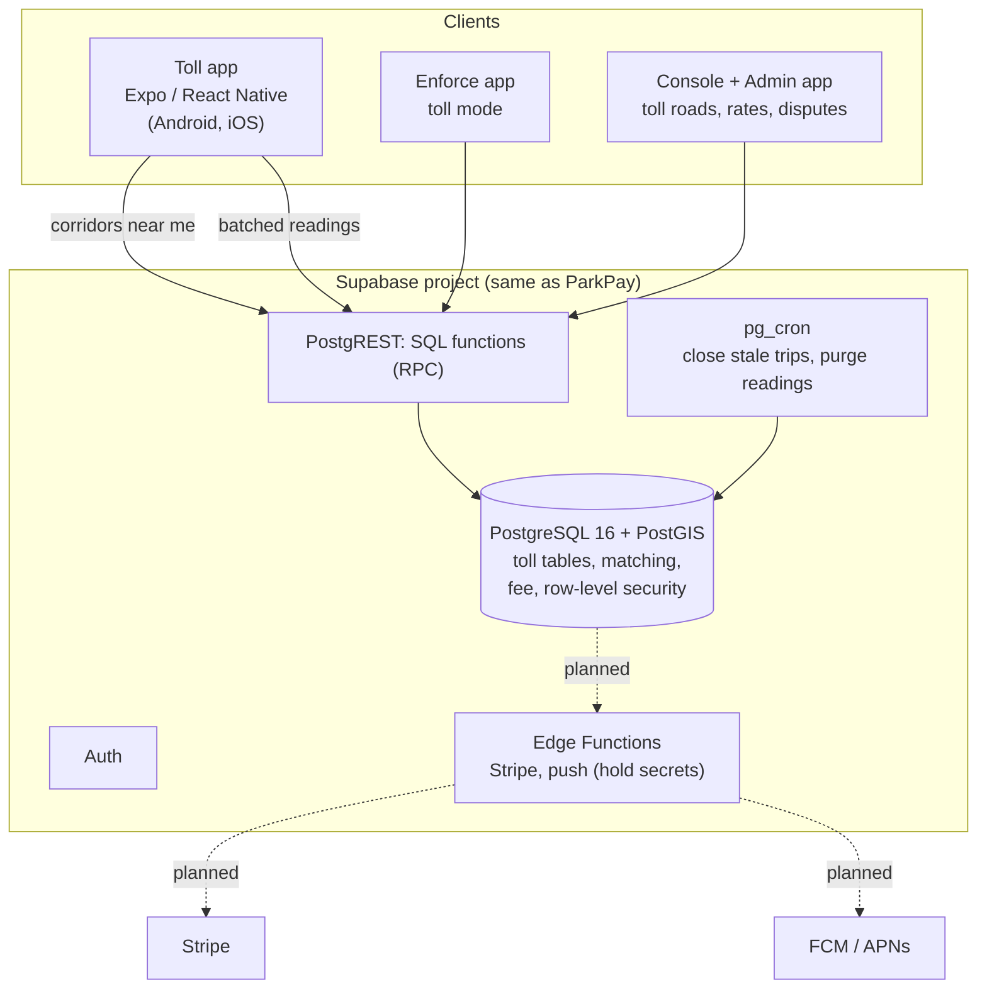
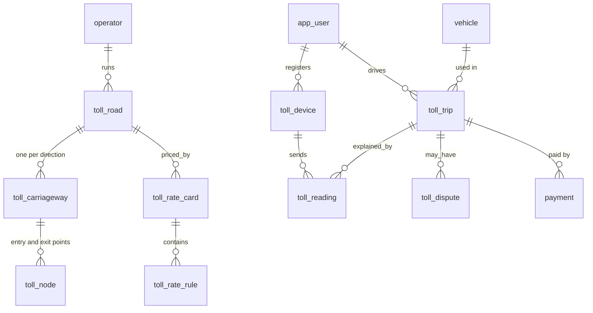
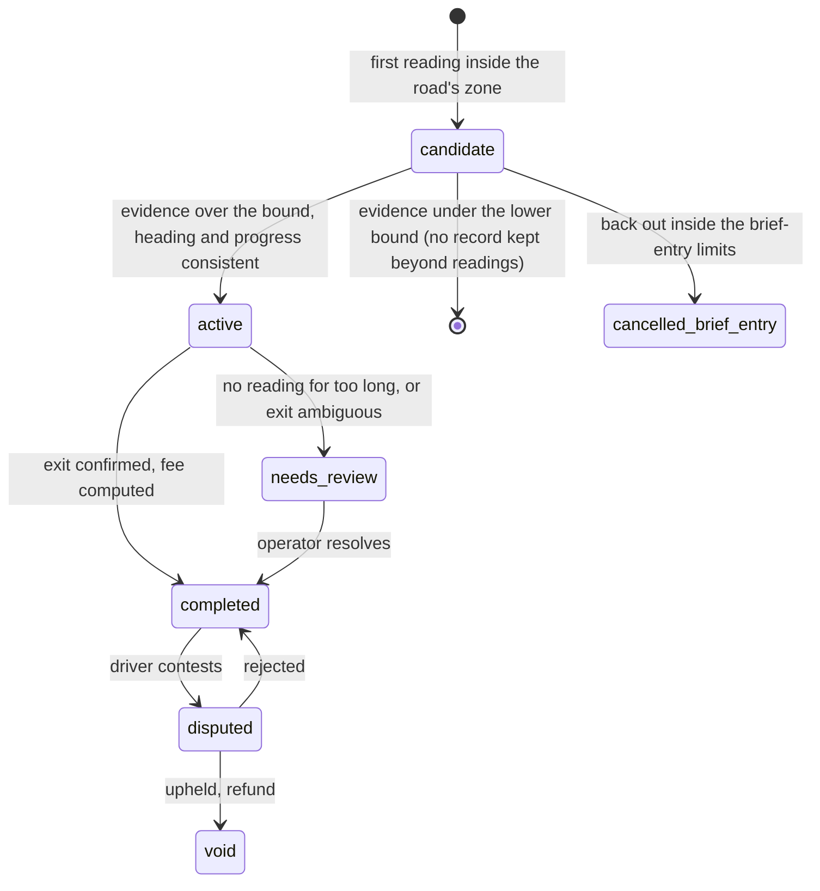
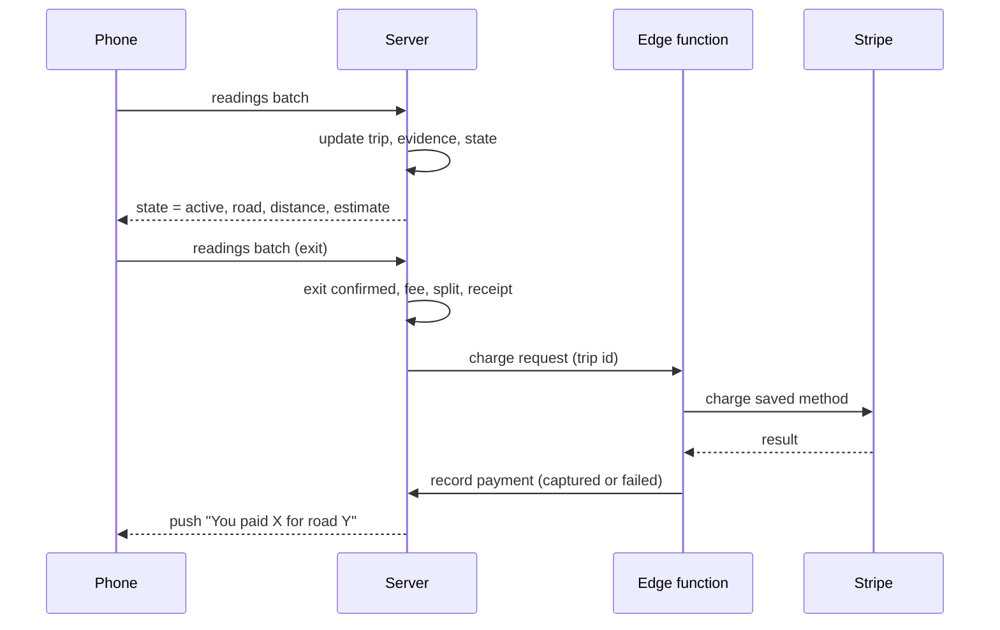
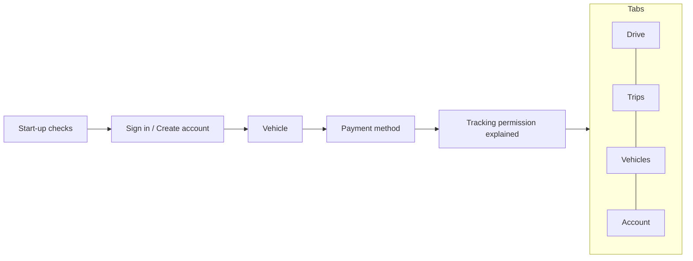

# ParkPay Toll master specification

"ParkPay Toll" is a working name, like "ParkPay". The product needs its own name and trademark search before any store upload (the bundle id cannot change afterwards). Diagrams use Mermaid.

Labels used in this document:

| Label | Meaning |
|---|---|
| **Patent** | Stated in the patent text (paraphrased) |
| **Exists** | Already in this repository and tested |
| **Design** | Proposed here, not built |
| **Proposed value** | A number chosen as a starting point. Must be calibrated on real drives |
| **Owner** | Needs a decision or an action only the owner can take |

## Contents

1. Summary and honest status
2. Where this came from: the patent, the 2012 material
3. What the patent specifies and what it leaves open
4. Claim-by-claim traceability
5. Users, roles and what is reused from ParkPay
6. System architecture
7. Road model and data model
8. Server API
9. Deciding that a phone is on a toll road
10. Sampling, battery and the phone side
11. Entry, exit and the awkward cases
12. Pricing and money
13. Enforcement
14. The surfaces: toll app, officer mode, console, site
15. Security, fraud and privacy
16. Testing and calibration plan
17. Operations, builds, release
18. Gap register
19. Roadmap and build order
20. Decisions the owner must make
21. Glossary and file map
22. How this document was checked

---

## 1. Summary and honest status

A driver installs the app once, registers a vehicle and a payment method, and then drives. The phone reports a few location readings when it is near a toll road. The server compares those readings with the road's shape, decides whether the vehicle was on the road, between which entry and exit, and charges the account after the vehicle leaves. There are no booths, gantries or transponders: the road is a shape in a database, like a parking area.

| Part | Status | Notes |
|---|---|---|
| Patent text read in full | Done | Section 2. From the Google Patents page; the USPTO text should be read before any filing or enforcement |
| Accounts, vehicles, operators, auth, row-level security | **Exists** | Shared with ParkPay |
| Officer app and plate lookups | **Exists** | Parking only today; toll mode is a design (section 13) |
| Operator console and Admin app, drawing engine | **Exists** | Polygons only; polyline tools are a design (section 14) |
| Payment | **Simulated** in ParkPay | Same limitation here |
| `toll_road`, `toll_trip` tables | **Exists as empty drafts** | 0 rows, no policies, no functions. Checked in the live project on 2026-11-21. Section 7 replaces them |
| Proposed toll schema | **Design, parse-checked** | Run inside a transaction that was rolled back against the live project: it applies cleanly, nothing was kept |
| Road model, matching engine, fee engine, sampling, apps, console screens | **Not built** | This document is the plan |
| Toll patent ownership and maintenance-fee status | **Unverified** | Owner's stated position only (section 2.3) |

So: the foundations are shared and working, the toll-specific parts are a design. The most important finding is in section 9: a phone can tell a toll road from a free road next to it only when they are far enough apart, and the document says how far, with the arithmetic.

---

## 2. Where this came from: the patent, the 2012 material

### 2.1 The patent

| | |
|---|---|
| Number | US 10,726,403 B2, published as US 2015/0154578 A1 (application US 14/409,408; PCT/IN2013/000315, WO2013190566A2) |
| Title | Centralized toll tracking, payment and monitoring system using geo location enabled devices |
| Inventors listed | Adityakumar Akshaikumar Aggarwal, Sunil Goel. Assignee listed as an individual |
| Priority | 22 Jun 2012 (India, IN1811/MUM/2012) |
| Filed | 15 May 2013 |
| Granted | Grant event 8 Jul 2020; publication dated 28 Jul 2020 |
| Status shown by Google | Active, adjusted expiry 18 Feb 2034. Google says this is an assumption, not a legal conclusion |
| Entity status | Micro-entity shown (2018) |
| Maintenance | A fee reminder was mailed 18 Mar 2024. The page does not show whether the fee was paid |
| Classes | G06Q50/40, G06Q20/14, G06Q20/145, G07B15/06, G07B15/063 |

Source: `docs/sources/patents_google-patents-summary.md` and a full read of the Google Patents page on 2026-11-21. The page's text has scanning errors ("toil" for "toll"); the claims below are paraphrased from the best reading.

### 2.2 What else in the folder mentions tolls

| Item | What it says |
|---|---|
| Pitch deck v8, slide 18 | "Future toll application: patent pending." Device location tracks a vehicle on a toll road and charges the linked account; multiple readings overcome the inaccuracy of one reading |
| Student website text | One line: "pay the toll on a single click". It reads like a slip in the parking text, not a toll feature |
| NDAs (May 2012) | The "Idea" is "geo-location based parking and toll payment plus location-based marketing" |
| 2012 code, versions v0 to v8 | No toll code. A search of the C#, JavaScript, HTML and SQL files found no mention |
| Rebuild schema | `toll_road`, `toll_trip` drafts, empty; `location_ping` table used by parking |

There is **no 2012 toll prototype, no toll screenshots and no toll business data** in the folder. The patent text is the only detailed source. Everything below is built from it plus engineering.

### 2.3 Ownership and legal caveats (read before any launch or enforcement)

- The project's standing assumption is the owner's own statement that they own the patents. No assignment or licence is in the folder. Keep the recorded assignment (USPTO) at hand, and confirm maintenance-fee status and entity status with a patent attorney. This document does not state ownership as verified.
- The mapping in section 4 compares the design with the claims so that nothing is built by accident or left out by accident. It is **not** an infringement or validity analysis. A freedom-to-operate opinion is a separate job for an attorney.
- US patents are national. India, Canada, EU and other coverage is not checked.
- The company names on the 2012 deck belong to another company. The product needs its own name.

---

## 3. What the patent specifies and what it leaves open

This table is the most useful one in the document: it shows where the design is free and where engineering must supply the answer.

| Topic | Patent says | Patent does **not** say | This document |
|---|---|---|---|
| Road in the database | A repository of toll road information is compared with readings. Entry and exit points exist, different exits carry different distances and charges | Segments, geometry format, how entry and exit points are stored, schema | Section 7 |
| Deciding "on the toll road" | "Statistical algorithms" over several discrete readings, compared with the road's geometry, to overcome single-reading error | Any method, confidence measure, threshold, map matching | Section 9 (sequential probability ratio test) |
| Number of readings | Set by road length and vehicle speed (claim 1); app adjusts by distance from the road and speed to save battery (claim 11) | Any number, interval, distance or formula | Section 10, with a computed table |
| Wrongful entry | Not charged if the vehicle returns before a time and distance limit (claim 8). Description: "x %" of the road or a "certain fixed limit" | The values | Section 11, proposed values per road |
| Two devices in one vehicle | The app detects other registered devices in the vehicle; the cloud disables payment on all but one | How detection works; what happens for different accounts | Section 11.4 |
| Rates | Rule engine by entry day and time, speed on the road, time on the road, toll plan (claim 5). Prepaid day/week/month passes or pay per use | Formulas | Section 12 |
| Enforcement | Officer's app asks the cloud whether a vehicle on the road is being tracked for payment (claim 1). Optional plate camera, OCR, QR code, booth and EZ-Pass-type data | How "being tracked" is judged; ticket rules | Section 13 |
| Payment | One-time registration. Debit the registered account after exit. Credit the operator minus an agreed service charge | Prepaid wallet, batching, failure handling | Section 12 |
| Access channels | Smartphone app, web, SMS, voice for registration; the device talks to the cloud over the cellular network | | App and web first; SMS and voice are later (gap register) |
| Phone dead | The driver uses a manual booth; the attendant reads the cloud record | What to do on a road with no booth | Section 11.5 |
| Privacy | Payment profile kept apart from the basic profile; credentials may be stored encrypted on the device; officer data is encrypted | Retention, consent, anonymisation, policy | Section 15 |
| Numbers | None. "x %" and "certain fixed limit" are placeholders | | Everything numeric here is a proposed value |

---

## 4. Claim-by-claim traceability

Paraphrased from the Google Patents text. Claim 1 is the only independent claim; claims 2 to 11 depend on it. Read the exact claim wording on USPTO Patent Center before relying on this table.

| Claim | In plain words | Design element | Section | State |
|---|---|---|---|---|
| 1 | Cloud system with repositories of customer, toll road, vehicle tracking, payment, vendor and transaction data | Tables in section 7 | 7 | Design |
| 1(a)(i) | Decides if a customer's vehicle is on a toll road the system manages, when the vehicle may be on a mix of toll and non-toll roads | Sequential test over readings against each carriageway | 9 | Design |
| 1(a)(ii) | Tracks with geo-fencing and many discrete readings | On-device corridor zones plus uploaded readings | 9, 10 | Design |
| 1(a)(iii) | Calculates the fee | Toll fee function | 12 | Design |
| 1(a)(iv) | One-time registration before first use | Registration step; `toll_device`, vehicle, payment method | 14 | Design |
| 1(a)(v), (vi) | Registers the account, debits it after exit | Payment flow | 12 | Design (simulated first) |
| 1(b) | Customer devices registered with the cloud, tracking app, cellular network, GPS and network location, network location when GPS is unavailable | `toll_device`; the `source` column on readings | 7, 10 | Design |
| 1(c) | Officer devices run an enforcement app that asks the cloud whether a vehicle is tracked | Officer toll lookup | 13 | Design |
| 1 (method) | Decision by comparing many readings with the road geometry; readings while on, entering, exiting or approaching; app started before the road or kept in the background | Sections 9 and 10 | 9, 10 | Design |
| 1 (reading count) | Number of readings set from road length and speed | Interval rule | 10.2 | Design |
| 1 (duplicates) | Detect other registered devices in the vehicle; disable payment on all but one | Co-travel detection and payer election | 11.4 | Design |
| 2 | Officer's app identifies a vehicle the cloud tracks for payment | `officer_check_toll` | 13 | Design |
| 3 | Debit through an external payment system after the vehicle exits; send a debit notice after validating the travel | Stripe flow, push notice | 12 | Design |
| 4 | All communication over the cellular network; charged automatically with no action | Background operation | 10 | Design |
| 5 | Rule engine by day and time of entry, speed, time on road, plan | `toll_rate_rule` | 7, 12 | Design |
| 6 | Device may be pager, smartphone, laptop, embedded GPS unit, palmtop | Smartphone first; other types are not designed | 18 | Open |
| 7 | App sends a series of readings; device receives confirmation messages | Readings API; confirmation in the response and by push | 8 | Design |
| 8 | Entry by mistake, return before limits: no charge | Brief-entry rule | 11.2 | Design |
| 9 | Background operation; the cloud decides automatically with no manual input | Same as claim 4 | 10 | Design |
| 10 | Rates changed by editing road information; new roads added the same way | Console road editor; data, not releases | 14 | Design |
| 11 | App adapts reading frequency to distance and speed to save battery | Section 10.2 table | 10 | Design |

---

## 5. Users, roles and what is reused from ParkPay

One account system, the same four roles (`driver`, `officer`, `operator_admin`, `platform_admin`). An operator is a toll road owner instead of a parking authority; the `operator` table already holds name, country, time zone, currency and service fee.

| Component | Reused as is | Changed | New |
|---|---|---|---|
| Sign-in, profile, vehicles, accounts | Yes | | |
| Operators, roles, audit log, versions | Yes | | |
| Payment and receipt pattern | Yes | `payment` and `citation` gain a `toll_trip_id` | |
| Rate rules engine idea (rules by day and time, highest priority wins) | The pattern | Rules key on time of **entry**, add distance | `toll_rate_*` |
| Geometry engine (`packages/shared/geometry.ts`) | Metric frame, snapping, undo | Add polylines: length, projection, chainage, bearing | Road editor |
| Officer app | Sign-in, plate lookup, tickets | Toll mode | |
| Operator console and Admin app | Shell, dashboard, staff, audit | | Toll roads tab and screens |
| Database test harness | Yes | | Toll test groups |
| Map matching, sampling, on-device zones | | | Everything in sections 9 and 10 |

Decision (Design, recommended): the toll product is a **fourth variant of the same mobile codebase** (`APP_VARIANT=toll`), with its own store listing, name, id and icon, in the way Enforce and Admin are variants today. Reasons: it reuses sign-in, vehicles, theme and the Supabase client; it needs its own store review because of background location and its own justification video; and a person who only parks should not see toll prompts. The alternative, a toll tab inside the driver app, is possible but makes the driver app's store review about tolls too. Owner decision (section 20).

---

## 6. System architecture

Design rules, carried over from ParkPay and added to:

1. **The server decides.** Whether a vehicle was on the road, between which nodes, and the fee are computed in the database. The phone shows estimates only.
2. **No server of our own.** Matching and fees are SQL functions behind row-level security, as in ParkPay. Stripe and push need small Edge Functions because they hold secrets.
3. **The server never calls Google.** Distances and projections are PostGIS. The phone draws its own map.
4. **Send less location, not more.** Readings far from any toll road never leave the phone (section 10.3). Parking uploads about one position a minute while parked; a toll app that streamed a driver's whole day would be a different and heavier privacy promise.
5. **Benefit of the doubt.** When the evidence is ambiguous the system does not charge, and flags the trip for review (section 11).
6. **Frozen terms.** The rate card in force at entry is the one used, like the parking tariff.

---

## 7. Road model and data model

### 7.1 Why the draft tables are replaced

The draft `toll_road.corridor` is one buffered polygon around a road. A polygon cannot say which direction a vehicle travels, where the entry and exit points are, how far along the road a position is, or what the charge is between two exits. Those four things are what the patent's pricing needs ("different exit points carry different distances and charges"). A **centreline with measured nodes** carries all four. Both draft tables hold 0 rows and have no policies, so replacing them loses nothing.

### 7.2 The model

| Table | Purpose | Key columns |
|---|---|---|
| `toll_road` | A road run by one operator | `operator_id`, `name`, `active` (published), `min_confidence`, `brief_entry_m`, `brief_entry_s`, `valid_from`, `valid_to`, `archived_at` |
| `toll_carriageway` | One direction of travel | `road_id`, `direction`, `centreline` (LineString drawn in travel direction), `half_width_m` |
| `toll_node` | An entry or exit point | `carriageway_id`, `name`, `kind` (entry, exit, both), `chainage_m` (metres from the start of the centreline), `location` |
| `toll_rate_card`, `toll_rate_rule` | The tariff | currency, minimum, daily maximum; rules by vehicle class, entry day and time, optional from-node and to-node, per-kilometre or flat price, priority |
| `toll_device` | A registered phone (claim 1(b)) | `user_id`, `install_id`, `platform`, `default_vehicle_id`, `is_passenger`, `disabled_at` |
| `toll_trip` | One journey on one carriageway | user, vehicle, device, road, carriageway, frozen rate card, entry and exit node, status, entry and exit chainage, distance, `confidence`, fee, service fee, payout, `receipt_no`, `review_reason`, `idempotency_key` |
| `toll_reading` | One raw location fix | device, trip, time, point, accuracy, speed, heading, `source` (gps or network) |
| `toll_dispute` | A driver contests a charge | trip, reason, status, resolution |

**Chainage** is the distance along the centreline from its start. Every node, and every reading once projected onto the road, has one. Distance travelled between two points is the difference of their chainages. This turns a 2-D geometry problem into a 1-D one, which is what makes matching, pricing and exit detection simple and testable.

Rules the database enforces (Design):

| Rule | How |
|---|---|
| A vehicle has at most one open toll trip | Unique partial index on `vehicle_id` where status is `candidate` or `active` |
| A retried upload never creates a second trip | Unique `(user_id, idempotency_key)` |
| A completed trip has an exit time, a fee and a receipt number | Check constraint |
| A centreline is valid, on the globe, within a length range; nodes lie within a few metres of it; chainages ascend with travel | Trigger `toll_road_guard`, like `parking_area_guard` |
| A published road does not overlap another operator's published road for more than a few metres | Same reason as parking: the nearest match wins, so overlap lets one operator collect another's tolls |
| Editing or publishing another operator's road is refused | Same operator checks as parking |
| Payment and tickets can point to a toll trip | `payment.toll_trip_id`, `citation.toll_trip_id`; the payment target check allows any of the three |

The full DDL (9 tables, 2 enums, indexes, checks, row-level security on) was applied inside a transaction against the live project on 2026-11-21 and rolled back: it parses and applies cleanly, and the drafts were still in place afterwards. The DDL is saved as `docs/toll-proposed-schema.sql`. It is deliberately **not** in `supabase/migrations/`, so the migration runner cannot apply it by accident; it becomes a migration, with tests, when phase T1 starts.

Chainage in SQL: `ST_LineLocatePoint(line, point)` gives the fraction along the line. Multiplying by the geodesic length is a good approximation on short, straight roads (a test returned 4,033.8 m at the midpoint of an 8,067.6 m line). For long or curved roads the build should accumulate geodesic length segment by segment, and the parity test (section 16) should prove the choice.

### 7.3 Published, versioned, archived

Same lifecycle as a parking area: Draft, Published, Archived; every save writes a version with a full snapshot and an audit line. A rate change applies to **new** trips only; an open trip keeps the card it entered with.

---

## 8. Server API

Design. Clients call SQL functions through RPC with the user's token; the user is read from the token, never from a parameter. Errors are short codes the app turns into sentences.

### 8.1 Driver app

| Function | Does |
|---|---|
| `toll_register_device(install_id, platform, app_version, vehicle_id)` | One-time registration of this phone (claim 1(b)); idempotent |
| `toll_corridors_near(lat, lng, radius_m)` | Published carriageways near a point: simplified centreline, nodes, `half_width_m`. Used by the phone to decide when to wake and upload. Radius capped |
| `toll_submit_readings(device_id, readings[], idempotency_key)` | Stores up to 50 readings, updates the trip, returns the state: `none`, `candidate`, `active`, `completed`, `needs_review`, with the road, distance so far and an estimated fee |
| `toll_my_active_trip()`, `toll_my_trips(limit)` | Current and past trips |
| `toll_set_passenger(device_id, is_passenger)` | "I am a passenger": this phone never pays |
| `toll_dispute_trip(trip_id, reason)` | Contest a charge |
| `toll_pay_outstanding()` | Pay trips whose charge failed (simulated first) |

### 8.2 Officer

| Function | Does |
|---|---|
| `officer_check_toll(plate, region, lat, lng)` | `paid_or_tracking`, `not_tracked`, or `unknown_vehicle`; logged |
| `officer_issue_toll_citation(plate, region, reason, fine, lat, lng)` | Ticket with `toll_trip_id` empty and reason "toll not paid" |

### 8.3 Operator admin

`operator_toll_roads()`, `operator_check_toll_road(...)` (length, node order, overlap with other published roads, and the **confusability report** in section 9.5), `operator_save_toll_road(...)`, `operator_publish_toll_road(id, publish)`, `operator_toll_trips(...)`, `operator_toll_report(from, to)`, `operator_toll_disputes()`, `operator_resolve_toll_dispute(id, upheld, note)`, `operator_refund_toll_trip(id, amount, reason)`.

### 8.4 Internal

`_toll_update_trip(trip)` (the matching step), `compute_toll_fee_cents(...)`, `toll_close_stale_trips()` (job), `toll_purge_readings()` (job), `_toll_confusers(carriageway)`.

### 8.5 Error codes (additional)

`device_not_registered`, `vehicle_required`, `too_many_readings`, `readings_out_of_order`, `invalid_reading`, `toll_road_not_found`, `toll_trip_not_found`, `trip_not_disputable`, `invalid_centreline`, `node_off_road`, `nodes_not_ordered`, `road_overlaps_other_operator`, `no_rate_card`.

---

## 9. Deciding that a phone is on a toll road

This is the core of the patent ("statistical algorithms", "multiple readings") and the part that the patent leaves entirely open. The design below is a sequential probability ratio test over the readings, with chainage and heading checks.

### 9.1 What one reading is worth

A reading has a position and an **accuracy**. Android defines accuracy as the radius that contains the true position with 68% probability. For a circular Gaussian error that radius is 1.51 standard deviations (computed: sqrt(-2 ln 0.32)), so the one-axis error is

    sigma = accuracy / 1.51

iOS reports a horizontal accuracy as a radius of uncertainty but does not state the confidence level, so the factor must be measured on iPhones (section 16). The sideways distance `d` from a reading to a centreline is a one-axis quantity, so it is treated as a normal variable with that sigma, floored at a proposed 3 m.

### 9.2 Two hypotheses

For each carriageway and each reading:

- **H1** the vehicle is on this carriageway, so the true sideways distance is about 0 (inside `half_width_m`).
- **H0** the vehicle is somewhere else: another road at a known separation `s` (a "confuser", section 9.5), or simply not near.

The log-likelihood ratio of one reading is

    LLR = ln p(d | H1) - ln p(d | H0)

With a known alternative road at sideways distance `d0` from the reading and `d1` to the toll road, and equal sigma, this is `(d0^2 - d1^2) / (2 sigma^2)`. Example, accuracy 10 m (sigma 6.6 m), reading 5 m from the toll road and 20 m from the free one: `(400 - 25) / 87.1 = 4.3` nats (computed).

The test **accumulates** LLR over readings. The trip becomes `active` when the sum crosses the upper bound; it is dropped when it crosses the lower bound. For equal prior odds, a 99% posterior needs a sum of ln 99 = 4.60 nats, and 99.99% needs ln 9999 = 9.21. `toll_road.min_confidence` sets the bound per road (default 0.99, proposed).

### 9.3 Readings are not independent

GPS errors are correlated over seconds. Adding the LLR of ten readings taken one second apart as if they were ten independent samples overstates the evidence about ten times. The design therefore (proposed values):

| Rule | Value |
|---|---|
| Count at most one reading per **20 s** toward the evidence (the rest only refine the position) | 20 s |
| Cap the evidence from any one reading | 6 nats |
| Drop readings with accuracy worse than | 100 m |
| Drop readings that imply a speed over | 70 m/s between consecutive fixes |

The 20 s correlation time is a guess to be replaced by a measurement (section 16). It is deliberately cautious.

### 9.4 How far apart must two roads be? (computed)

If the vehicle is on road 1 and road 2 runs `s` metres away, each independent reading is worth on average `s^2 / (2 sigma^2)` nats. Independent readings needed to reach 99% / 99.99% (prior odds 1:1):

| Accuracy (sigma) | s = 3 m | s = 5 m | s = 10 m | s = 25 m | s = 50 m |
|---|---|---|---|---|---|
| 5 m (3.3 m) | 12 / 23 | 5 / 9 | 2 / 3 | 1 / 1 | 1 / 1 |
| 10 m (6.6 m) | 45 / 90 | 17 / 33 | 5 / 9 | 1 / 2 | 1 / 1 |
| 20 m (13.2 m) | 180 / 360 | 65 / 130 | 17 / 33 | 3 / 6 | 1 / 2 |

Reading it: with 10 m accuracy and one independent reading per 20 s, a free road 10 m from the toll road needs about 5 readings, so around 100 s of driving (about 2 km at 20 m/s). A road 3 m away is **not distinguishable** on any realistic stretch. These are expected values; the simulator (section 16) measures the real distribution.

Consequences, stated plainly:

1. **Separated express lanes beside free lanes (3 to 10 m apart) cannot be decided by position alone.** They need entry and exit topology (the ramp or slip lane where the vehicle crosses into the toll lane) or are out of scope.
2. **Bridges, tunnels, and stand-alone highways with no parallel free road within about 25 m are the right first targets.** There the decision takes one or two readings.
3. The patent's claim to "overcome the inaccuracy of a single reading" is real: one reading cannot decide, several can, but only up to the limits in the table.

### 9.5 Confusers and the confusability report

A **confuser** is a non-toll road that could explain the readings. The database does not hold the free road network, so two options (Design):

| Option | How | Caution |
|---|---|---|
| Operator draws them | The console lists the stretches where a toll road is closer than a set distance to another road, and the operator marks the free road | Slow, exact |
| Import from OpenStreetMap | Load nearby roads as `toll_confuser` lines | OpenStreetMap data carries the ODbL licence with attribution and share-alike duties on derived databases. Check with a lawyer before using it in a product |

Whichever is used, the console runs a **confusability report** when an operator saves a road: for each carriageway, the length of road within 25 m, within 10 m and within 5 m of any confuser, and the expected readings needed. A road with a long stretch within 5 m cannot be published as "position-decided"; it must use topology (section 11.3) or be marked "manual review".

### 9.6 Direction and progress

Position alone also confuses the two directions of a divided road. Two cheap checks:

- **Heading**: the reading's heading must be within a proposed 30 degrees of the centreline bearing at its projected point.
- **Progress**: successive projections must increase chainage, at a rate consistent with the reported speed.

A vehicle that is stopped or crawling gives no reliable heading; those readings add no heading evidence.

### 9.7 The trip state machine

The entry time is **back-dated**. Confirmation arrives several readings after the vehicle crossed the entry, so the server takes the earliest consistent reading, projects it onto the carriageway, and snaps to the nearest entry node within a tolerance (proposed 150 m). The toll is calculated from that node. The driver is told "entered X" when confirmed, not when it happened.

### 9.8 Where the maths runs

Per reading the update is constant work: project the point onto the centreline, compute the LLR, add it to the running sum stored on the trip, check the bounds. That is a few PostGIS calls inside a PL/pgSQL function, so the "no server of our own" rule holds. If profiling shows it too slow at scale, the same function can move to an Edge Function without changing the API.

---

## 10. Sampling, battery and the phone side

### 10.1 Zones

The phone downloads the simplified corridors near it (`toll_corridors_near`) and tracks four zones by its distance to the nearest published carriageway:

| Zone | Distance | GPS | Upload |
|---|---|---|---|
| Far | more than 5 km | Off. Only coarse movement and OS geofence circles that wake the app | Nothing |
| Approach | 0.5 to 5 km | On at a computed interval (10.2) | **Nothing leaves the phone**; the last few minutes are kept in a ring buffer |
| Near | inside the corridor plus 500 m | Every 2 to 5 s | Batch every 15 s, including the ring buffer once |
| On road | trip candidate or active | Every 2 to 20 s (10.2) | Batch every 15 to 30 s |

OS geofences: expo-location supports geofencing with circles. iOS allows about 20 regions per app and Android 100 (to confirm in a device spike). Circles are placed around entry areas so the OS wakes the app; ParkPay already does this for parking lots.

### 10.2 The interval rule (computed)

Away from the road, the next reading is due when the vehicle could first reach the road:

    t_arrive = max(0, distance - 500 m) / max(1.3 * speed, 15 m/s)
    interval = clamp(t_arrive / 3, 5 s, 120 s)

Resulting interval in seconds (computed). Rows: distance to the nearest entry; columns: speed.

| Distance | 0 m/s | 13.9 m/s (50 km/h) | 25 m/s (90 km/h) | 33 m/s (119 km/h) |
|---|---|---|---|---|
| 30 km | 120 | 120 | 120 | 120 |
| 10 km | 120 | 120 | 97 | 74 |
| 5 km | 100 | 83 | 46 | 35 |
| 3 km | 56 | 46 | 26 | 19 |
| 1.5 km | 22 | 18 | 10 | 8 |
| 0.8 km | 7 | 6 | 5 | 5 |
| 0.3 km | 5 | 5 | 5 | 5 |

The three at the end of the formula means three readings fit before the earliest possible arrival, so one lost reading does not cause a missed entry. At 33 m/s a 120 s interval covers 4.0 km, which is why far away is cheap and near is dense.

**On the road**, spacing is bounded so no gap hides a departure (claim 1: readings set from length and speed):

    interval = clamp(400 m / speed, 2 s, 20 s)

That gives 20 s at 50 km/h, 16 s at 90 km/h and 12 s at 119 km/h. A 12 km road at 25 m/s then yields about 30 readings; at one reading per second it would yield 480. The evidence rules in 9.3 mean the extra readings add almost nothing, so the slower rate is cheaper at no loss.

All numbers in this section are **proposed values**. The patent gives none.

### 10.3 What leaves the phone

Only readings from Near and On road, plus the ring buffer taken on entering Near. Far and Approach positions are never uploaded. This keeps the privacy promise narrow: "we see where you are only on and next to a toll road".

### 10.4 Platform work (to be confirmed in a spike on real phones)

| Item | Android | iOS |
|---|---|---|
| Permission | Foreground and background location ("Allow all the time") | "Always" |
| Background run | Foreground service with a visible notification, location service type | Background location mode, system indicator |
| API | `Location.startLocationUpdatesAsync` with batching, `startGeofencingAsync` | Same, with automotive activity type |
| Store review | Background location needs a declaration and a short video showing why it is needed | Review of the "Always" purpose strings |
| Battery saver, app killed by user | The OS may stop updates: the app cannot guarantee tracking | Same |

What the app must tell the driver plainly: if tracking stops (battery saver, force-quit, no signal), tolls may not be recorded and enforcement can still find the vehicle (section 13).

### 10.5 Phone and server agree

The phone runs the zone logic locally with the shared geometry package, so it must agree with PostGIS on distance to the carriageway. A parity test compares them on random points (section 16), exactly as ParkPay does for area matching.

---

## 11. Entry, exit and the awkward cases

### 11.1 Entry and exit nodes

A carriageway has ordered nodes. Entry is recorded at the entry node nearest the back-dated first on-road reading (within tolerance). Exit is recorded at the exit node whose chainage is nearest the last on-road reading **and** after which the vehicle leaves the corridor (sideways distance above `half_width_m + 2 sigma` for two independent readings). A trip with no matching node within tolerance goes to `needs_review`, not to a guessed charge.

### 11.2 Brief wrongful entry (claim 8)

If the vehicle backs out, meaning it exits at or before its entry chainage plus `brief_entry_m` within `brief_entry_s` seconds, the trip becomes `cancelled_brief_entry` and no fee is taken. Proposed per-road defaults: 300 m and 120 s; the patent gives "x %" and "a certain fixed limit" and no values. A road owner can change both, and the dispute flow covers the rest.

### 11.3 Entering from a ramp: topology decides

Where the toll lane and a free lane run close together, the decision comes from where the vehicle **joined**: a toll lane that can only be entered from a slip road is entered only by readings that pass along that slip road. Design: optional `toll_node` rows of kind `entry` placed on the ramp, and a rule "active only if the first consistent reading falls within the ramp's zone". This is the main route to supporting separated express lanes and must be proven on a real road before it is promised.

### 11.4 Two devices in one vehicle (claim 1)

| Case | Rule |
|---|---|
| Same account, two phones | Detect co-travel: the phones' readings stay within a few metres of each other with correlated speed and heading across several readings. The phone bound to the vehicle as default pays; the other is told "payment is on your other phone" and sends nothing for tolls |
| Same family, different accounts | Same detection; the account that owns the vehicle record pays |
| Passenger with their own account | The passenger has no matching vehicle. The app asks once "Are you the driver?" and remembers the answer (`toll_device.is_passenger`). Connecting to the car by Bluetooth, where the OS allows, can be used as an extra driver hint |
| Cannot decide | The earliest trip pays; the other is cancelled; both get a notice; the unique open-trip index per vehicle guarantees one charge |

How the patent's detection works is not described, so this is new design. The hard case (driver and passenger both using their own vehicle record) is a product decision for the owner.

### 11.5 Missing data

| Situation | Rule (proposed) |
|---|---|
| Tunnel or underpass, no GPS | Network location readings (claim 1(b)) are accepted at lower weight, flagged `source = network`; accuracy over 100 m is dropped |
| No exit reading | After a stale limit (proposed 10 minutes with no readings) the job closes the trip at the nearest exit ahead of the last confirmed position **only if** the gap is under a set distance; otherwise `needs_review`, no charge until resolved |
| Phone dead | There is no booth to fall back on (the patent's fallback is a manual booth). The vehicle is untracked; enforcement and plate billing are the control. Section 13 |
| Out-of-order or duplicate batches | Idempotency key per batch; readings are ordered by their time stamp; a batch that arrives late is merged if the trip is still open, else stored for review only |
| Device clock wrong | The server compares the batch's last reading time with its own clock and rejects batches more than a set skew in the future |

---

## 12. Pricing and money

### 12.1 Fee calculation

Same shape as the parking engine: implemented in SQL (authoritative) and TypeScript (estimate on screen), with shared test vectors.

1. Pick the **rate card** in force at the entry time and freeze it on the trip.
2. Pick the rule that matches the vehicle class, the entry **day and time of day in the operator's time zone**, and, if present, the from-node and to-node. Highest `priority` wins.
3. If the rule is flat, the fee is the flat price. If it is per kilometre: `billed distance = exit chainage - entry chainage`; fee = billed distance in km times the price per km.
4. Round **up** to a whole cent.
5. Cap at `daily_max_cents` per operator-local day for that vehicle and road (proposed), then raise to `min_charge_cents` if lower.

**Billed distance is the chainage difference, not the length of the GPS track.** Noise makes a measured path longer than the road: the jitter adds length even for a straight drive. Charging for the path would overcharge in exact proportion to GPS quality.

Worked example (computed): 11.4 km, 18 cents per km at the entry time, 100 cent minimum. 11.4 x 18 = 205.2, rounded up 206 cents. The operator's service fee at 8% is floor(206 x 800 / 10000) = 16 cents and the operator receives 190 cents. The 18-cent price and the 8% are examples, not proposals.

Rate dimensions the patent lists beyond time and distance: speed on the road and time on the road (claim 5). The design carries an optional `max_speed_kph` on a rule (average speed over the trip) and the trip stores its duration, so a rule can use either. Whether to charge by speed at all is an operator and legal question; it is built as a data option, off by default.

### 12.2 Split, receipts

Same formula as parking: `service_fee = floor(fee x bps / 10000)`, `operator_payout = fee - service_fee`, using the operator's existing `service_fee_bps` (Owner: whether tolls get their own percentage). Receipts `TL-<year>-<six digits>` from a database sequence.

### 12.3 Payment flow

Today the payment is simulated, as in ParkPay. Choices for real money (Owner):

| Option | For | Against |
|---|---|---|
| Charge each trip to the card | Simple; matches the patent text ("debit after exit") | A fixed fee per card charge makes very small tolls uneconomical |
| Batch charges (end of day or above a threshold) | Fewer fees | A delay between travel and debit; the attorney should read claim 1 and 3 against it |
| Prepaid balance | Cheapest per toll | Holding customers' money can be regulated in some places; needs a lawyer before building |

Failed charges: the trip stays `completed` with an unpaid payment; the app shows "pay outstanding"; enforcement sees the vehicle as `not paid` once a grace period ends.

---

## 13. Enforcement

### 13.1 What the officer sees (claim 1(c), claim 2)

`officer_check_toll(plate, region, lat, lng)` returns:

| Result | Meaning |
|---|---|
| `paid_or_tracking` | A trip for this plate is active, or completed and paid, on a road near the officer, with a recent reading near the officer |
| `not_tracked` | A vehicle on the road with no matching trip. Not proof of non-payment: the phone may be off |
| `unknown_vehicle` | The plate is not registered |

Every lookup is logged in `enforcement_check`, as in parking.

### 13.2 Tickets

Reuse `citation` with reason "toll not paid" and an empty `toll_trip_id`. Whether a ticket has legal force depends on the operator's authority (as with parking, tickets are platform notices until a city or road authority signs on).

### 13.3 Cameras, OCR, QR

The patent mentions plate cameras with OCR, QR codes on vehicles, and data from booths or EZ-Pass-type systems. None is designed in detail here. They are the way to close the "phone is off" gap, and they need an operator contract (gap register).

---

## 14. The surfaces: toll app, officer mode, console, site

### 14.1 Toll app

| Screen | What it does |
|---|---|
| Sign-up steps | Vehicle (plate, region, class), payment method, then a plain screen on why "Always" location is needed and what is uploaded (only on and next to a toll road) |
| Drive | Status line: Not near a toll road / Approaching X / On X, entered at Y, distance so far, estimated fee. A passenger switch. Tracking health: "tracking on" or "tracking limited because of battery saver" |
| Trips | Each trip: road, entry, exit, distance, fee, receipt, map of the matched stretch, "This is wrong" to dispute |
| Vehicles | Add, remove, default |
| Account | Name, payment method, pause tracking (with a warning that unpaid tolls may be fined), delete account, download my data |

Icon (proposed): burnt orange (#C2410C) with a white road-and-gantry mark, distinct from the green driver, navy and amber Enforce, and violet Admin icons. Generated by the existing `scripts/make-icons.py` with a fourth variant. Bundle id proposal `com.parkpay.toll`, scheme `parkpaytoll`, EAS profile `toll-preview`, channel `toll-preview`. Final names wait on the product name.

### 14.2 Officer mode

A "Toll" mode in the Enforce app: nearby tracked vehicles, check a plate, issue a toll ticket. Same sign-in; the officer's role already scopes them to one operator.

### 14.3 Console and Admin app

| Screen | What it does |
|---|---|
| Toll roads | List with status, length, confusability grade |
| Road editor | Draw the centreline per direction (polyline tool on the existing engine: snap to existing nodes and roads, length in metres, undo and redo), then place nodes by clicking on the line (the point is snapped to the centreline and chainage is computed). Live checks: length, node order, overlap with another operator's published road, **confusability report** (9.5) |
| Rates | Rate card and rules; a fee preview ("11.4 km at 07:50 on a Tuesday") using the same function as the server |
| Trips and reports | Revenue, trips, average distance, disputed and needs-review counts |
| Disputes | Open, uphold (refund), reject, with the trip's matched track drawn on the map |
| Needs review | Trips the system would not decide |

### 14.4 Site

A page on tolls, an addendum to the privacy policy (readings, retention), terms and support. Both stores require a privacy policy and a public account-deletion route.

---

## 15. Security, fraud and privacy

| Topic | Design |
|---|---|
| Identity, authorisation | As ParkPay: token identity, row-level security on every table, no policy means no access, all access through functions |
| Unpaid by silence | A user can turn the app off. The control is enforcement and plate billing, not the app. State this honestly to any operator |
| Spoofed location | Reject mock-location providers where the OS reports them; accept only plausible speed and continuity between readings; use Play Integrity and App Attest later. A determined spoofer cannot be stopped by software alone |
| Replay and double submit | Idempotency key per batch and per trip; unique open trip per vehicle |
| Rate limiting | Cap batches and readings per device per hour; reject over-size batches |
| Tampered clock or price | Server time and server fee only |
| Secrets | Phone carries the publishable key only. Stripe and push secrets live in Edge Functions |
| Data minimisation | Far and Approach positions never uploaded (10.3) |
| Retention (proposed) | Raw readings deleted 14 days after the trip closes, which covers a dispute window; if a dispute is open they are kept until it is resolved. Trip summaries and payments kept for finance as the tax rules require (to confirm per country) |
| Consent | A separate, plain consent step for tracking; revocable; the toll app does nothing before it |
| Account deletion | As ParkPay: anonymised profile, sign-in removed, financial records kept without the name; refused while a trip is open |
| Audit | Road edits, publishes, rate changes, refunds, dispute decisions |
| Legal | Privacy law differs by country (for example PIPEDA in Canada, GDPR in the EU). A lawyer must review the policy; none of this document is a compliance statement |

The patent says nothing about retention, consent or anonymisation. These rows are additions.

---

## 16. Testing and calibration plan

Nothing here has been run yet. This is what "proven" will have to mean.

### 16.1 Layers

| Layer | What | Target |
|---|---|---|
| Fee engine | Shared vectors in SQL and TypeScript: flat, per km, entry-time bands, minimum, daily cap, DST, rate change mid-trip (the open trip keeps its card) | Equal results |
| Geometry parity | Phone projection and distance against PostGIS on random points along curved and straight roads (as the parking 400-point test) | 0 mismatches beyond a stated tolerance |
| Matching engine | Unit tests on hand-built readings: on road, parallel road at 5, 10, 25 m, wrong direction, brief entry, stale trip | Expected state every time |
| Database suite | Roles and security for every function, one-trip-per-vehicle, idempotent batches, receipt format, refund limits, dispute flow | All pass, inside a rolled-back transaction as today |
| Public API | A scripted end-to-end run through the publishable key, like `scripts/live-smoke.mjs` | Pass |
| Console and app | Type checks, build, a click-through on emulator and browser | Clean |

### 16.2 The track simulator (the key instrument)

A script that drives a virtual vehicle along a drawn road and generates the fixes a phone would produce, then feeds them to the real server function. Error model:

| Ingredient | Why |
|---|---|
| Correlated error (first-order autoregressive, correlation time tau) with sigma from the accuracy | GPS error drifts, it is not white noise |
| Occasional multipath outliers (large jumps) | Urban canyons |
| Dropouts (tunnels, bridges) with network-only fixes | Claim 1(b) |
| The adaptive sampling schedule of section 10.2 | The real reading times |
| A parallel free road at separation `s` | Section 9.4's limits |
| Two phones in one car; a brief entry; phone killed mid-trip | Sections 11.2 to 11.5 |

Outputs: missed-charge rate, false-charge rate by separation, error of the entry and exit chainage in metres, the fee error in cents, and the distribution of readings needed. This replaces the guesses in sections 9 and 10 with measured numbers before any real money.

Proposed acceptance targets, **to be agreed with an operator, not claims**: no false charge on any road published as "position-decided"; missed charges tracked and reported; entry and exit chainage within 100 m at the 95th percentile on such roads.

### 16.3 Field tests

Drive a real road with a physical Android phone and an iPhone, several phone models, both directions, different weather and times, at least 20 passes per direction, with a second device logging ground-truth marks at the node positions. Measure the accuracy-to-sigma factor on each platform, the correlation time, the battery cost per hour in each zone, and the effect of battery-saver mode. Only then fix the numbers in sections 9 and 10.

### 16.4 Not yet tested (all of it), stated plainly

Every part of this design is untested. The only things checked so far are: the patent facts (two passes over the source), the proposed schema (applied and rolled back), and the arithmetic in sections 9, 10 and 12 (computed by a script).

---

## 17. Operations, builds, release

| Thing | Plan |
|---|---|
| Backend | The same Supabase project and migration runner. Toll tables arrive as new migration files with a test group each |
| Jobs | `pg_cron`: close stale trips every few minutes, purge readings daily |
| Builds | A fourth EAS profile and channel; `runtimeVersion` follows the app version, as for the other three |
| Over-the-air | JavaScript-only fixes as OTA updates; native permission changes need a store build |
| Console and site | Cloudflare Pages, as today |
| Monitoring | Error tracking, uptime check, and a **tracking-health metric**: share of expected trips that produced readings, by phone model and OS version |
| Stores | Separate listings. Google Play background-location declaration and video; Apple "Always" purpose strings; privacy labels; account deletion page |

---

## 18. Gap register

| # | Topic | Why it matters | Status |
|---|---|---|---|
| 1 | Toll patent ownership, assignment record, maintenance-fee and entity status | Ownership claims in store and investor material | Unverified (Owner) |
| 2 | Freedom-to-operate opinion | Building against a patent you may not own | Not done (attorney) |
| 3 | Product name, domain, trademark, bundle id | Cannot change after first store upload | Open (Owner) |
| 4 | Target road type and a first operator | Decides whether position-only matching works at all (9.4) | Open (Owner) |
| 5 | Road model and editor | Nothing works without roads | Design |
| 6 | Matching engine and simulator | The core claim | Design |
| 7 | On-device zones, background tracking, battery | Must work in the background | Design; needs a device spike |
| 8 | Real payments, failed charges, small-amount economics | The business | Not built; options in 12.3 |
| 9 | Server push for charge notices (claim 3) | Driver trust | Not built |
| 10 | Enforcement toll mode | Claim 1(c) | Design |
| 11 | Plate camera, OCR, QR, booth and transponder data feeds | Closes the "phone is off" gap | Not designed; needs operator contract |
| 12 | Passes (day, week, month) | In the patent description | Not designed in tables yet |
| 13 | Speed-based and time-on-road rates | Claim 5 | Data option designed, off by default |
| 14 | Devices other than smartphones (pager, laptop, embedded unit, claim 6) | Claim text | Not designed |
| 15 | SMS and voice registration, web registration | Description | Not designed |
| 16 | Disputes and appeals with legal force | Fairness | Basic dispute flow designed; legal force depends on the operator |
| 17 | Free-road data for confusers (and the OpenStreetMap licence) | Section 9.5 | Open |
| 18 | Privacy policy, consent text, data-processing terms with operators, lawyer review | Store and legal | Not drafted for tolls |
| 19 | Taxes and invoices for operators | Legal | Not built |
| 20 | Offline and flaky-signal behaviour on the phone | Real roads | Design |
| 21 | Accessibility audit, other languages | Store quality | Not done |
| 22 | Load test | Readings are a steady stream | Not done |
| 23 | Monitoring and restore-tested backups | Running a live service | Not done |
| 24 | Real-device and iPhone tests | Everything about GPS differs by phone | Not done |
| 25 | Maps key restriction for the new app id | Abuse of the key | Owner action |
| 26 | Market fit: toll roads often already use transponders or plate-camera billing | Why would an operator adopt a phone app | Open question for the owner; the patent's own pitch is "no roadside equipment" |

---

## 19. Roadmap and build order

Ordered so that each step can be proven without a car, and the risky unknown (does matching work on real phones) is tested early.

| Phase | Outcome | Needs a car? |
|---|---|---|
| T0 Decisions | Name, first road type, app as a variant, payment model, retention (section 20) | No |
| T1 Road model | Migration for the tables in section 7, guard trigger, console polyline editor, confusability report, fee engine with shared vectors | No |
| T2 Matching and simulator | The sequential test, brief entry, stale trips, co-travel; simulator; the numbers in sections 9 and 10 measured | No |
| T3 Phone MVP | Foreground tracking, readings upload, Drive and Trips screens, against a test road | Yes: one short road |
| T4 Background and battery | OS geofences, zones, batching, foreground service; battery measurement | Yes |
| T5 Real money and push | Stripe, charge notices, failed-charge flow | No |
| T6 Enforcement | Toll mode in the Enforce app | Some |
| T6b Express lanes | Ramp-topology rule (11.3) proven in the simulator, then on one real separated-lane road | Yes |
| T7 Pilot | One operator and one road; tracking-health dashboard; store tracks | Yes |
| T8 Growth | Passes, extra channels, cameras and plate data, more roads | Later |

Phases T1, T2 and T5 reuse a great deal of what ParkPay already proved (accounts, rate rules, payment, console, tests).

---

## 20. Decisions the owner must make

| # | Decision | My recommendation |
|---|---|---|
| 1 | Product name | Pick a name distinct from ParkPay's, then a trademark search |
| 2 | Separate app or a tab in the driver app | Separate app (a variant of the same code); section 5 |
| 3 | First road: bridge or tunnel or stand-alone highway, versus separated express lanes | **Owner answered 2026-11-21: support all.** Build in two stages: (a) bridges, tunnels and stand-alone highways first, because they work with position-only matching (9.4); (b) separated express lanes second, using ramp topology (11.3) and the confusability report (9.5), and only after the simulator and a real-road test show it decides correctly. Each road is graded in the console as "position-decided" or "topology-decided" and cannot be published as the first if its evidence is not enough |
| 4 | A first operator or pilot partner | Needed before T7; none exists in the folder |
| 5 | Payment: per trip, batched, or prepaid | Per trip or batched; prepaid only after legal advice |
| 6 | Own service-fee percentage for tolls | Reuse the operator's percentage for now |
| 7 | How to treat "phone off" evasion | Enforcement plus plate billing, agreed with the operator |
| 8 | Reading retention | 14 days after the trip closes |
| 9 | Passenger rule | Ask once, remember the answer |
| 10 | Patent paperwork | Attorney: assignment record, maintenance fees, freedom to operate |
| 11 | Free-road data source | Operator-drawn first; OpenStreetMap only after a licence check |

---

## 21. Glossary and file map

| Term | Meaning |
|---|---|
| Carriageway | One direction of a toll road, drawn as a centreline in the direction of travel |
| Centreline | The line along the middle of the road |
| Chainage | Metres along the centreline from its start. Distance between two points on the road is the difference of their chainages |
| Node | An entry or exit point at a chainage |
| Reading | One location fix with its accuracy, speed and heading |
| Accuracy and sigma | Accuracy is the 68% radius the phone reports. Sigma is the one-axis standard deviation, accuracy divided by 1.51 |
| LLR, nats | Log-likelihood ratio, the evidence a reading gives for "on this road" against "elsewhere". Nats are its unit |
| SPRT | Sequential probability ratio test: add evidence reading by reading until a bound is crossed |
| Confuser | A non-toll road that could explain the readings |
| Brief entry | Entering by mistake and leaving at once; not charged |
| Frozen card | The rate card in force at entry, kept for the whole trip |
| GEM device | The patent's term for a geo-location enabled mobile device |

| To change | Edit |
|---|---|
| Toll tables and rules on the server | A new file in `supabase/migrations/`, plus a group in `supabase/tests/run.mjs` |
| Fee logic | SQL `compute_toll_fee_cents` **and** a TypeScript twin in `packages/shared`, with shared test vectors |
| Matching thresholds | The per-road columns and the matching function; the simulator must be re-run |
| Geometry (polyline, chainage) | `packages/shared/src/geometry.ts` and its tests |
| App text for a server error | `apps/mobile/src/api/errors.ts` |
| Road editor | `apps/ops-console/src/` and `apps/mobile/app/area/` (a toll-road editor beside the area editor) |

Related: `MASTER-SPECIFICATION.md` (parking), `END-TO-END-PLAN.md`, `BUILDS-AND-RELEASES.md`, `SETUP-AND-TESTING.md`, and `docs/sources/patents_google-patents-summary.md`.

---

## 22. How this document was checked

Done on 2026-11-21.

| Item | How | Result |
|---|---|---|
| Patent facts (claims, description, dates, status) | The Google Patents page read in full, compared with the earlier summary in `docs/sources` | Matches, with two refinements: the application number, and the grant event and publication dates. Claims are paraphrased; the USPTO text was **not** read |
| What the folder says about tolls | Searched the knowledge base, the sources and the 2012 code | Only the patent text, deck slide 18, one stray line in the website text, the NDA, and the empty draft tables |
| Existing toll tables | Queried the live project | `toll_road` 0 rows, `toll_trip` 0 rows, no policies |
| Proposed schema | Applied inside a transaction on the live project, then rolled back | Applies cleanly; the original drafts were present afterwards |
| Chainage example | PostGIS check on a two-point line | 8,067.6 m long, midpoint 4,033.8 m |
| Numbers in sections 9, 10, 12 | Computed by a script | The 1.51 factor, the readings table, the interval table and the fee example are those the script printed |
| Everything else | Reasoned design | Not built, not tested |

**Does not hold, by design:** any behaviour of a real phone or road. Measurements come from the simulator and the field tests in section 16.
